# Hito 1 — Análisis exploratorio del metadata y definición del subconjunto Magdalena Medio

**Proyecto:** Clasificación bioacústica de especies de El Silencio (Yondó, Antioquia) — BirdCLEF 2025
**Fecha:** 2026-10-25 · **Reproducible con:** `python src/main.py` o ejecutando [`notebooks/hito1_eda_seleccion_especies.ipynb`](../notebooks/hito1_eda_seleccion_especies.ipynb) (semilla 42)

> [!NOTE]
> En esta versión del dataset el metadata se llama **`train.csv`** (en otras ediciones de BirdCLEF es `train_metadata.csv`); el contenido es equivalente. Todas las cifras de este documento salen de `reports/hito1/stats.json`, `reports/hito1/soundscapes_stats.json` y de las tablas en `reports/hito1/tables/`.

---

## 1. Resumen

| Indicador | Valor |
|---|---|
| Grabaciones focales (`train_audio`) | **28 564** / **206** especies (146 aves, 34 anfibios, 17 insectos, 9 mamíferos) · **280,5 h** · OGG Vorbis · 32 kHz · mono |
| Duración (`train_audio`) | mediana 21,0 s · P5 3,9 s · P95 110,9 s · máx. 1 774 s |
| Paisajes sonoros (`train_soundscapes`) | **9 726** archivos sin etiquetar · **162,1 h** (todos exactamente de 60,0 s, 32 kHz mono) · 56 sitios en El Silencio · 116 712 ventanas de 5 s |
| Desbalance (todas las clases) | 2 → 990 grabaciones por especie (ratio **495:1**, Gini 0,59); 53 especies con < 20 grabaciones |
| Cercanía geográfica | solo **10,4 %** de las grabaciones focales están a ≤ 300 km de El Silencio; 27,1 % en Colombia |
| **Subconjunto propuesto** | **16 aves**, 14 familias, 11 órdenes · **6 759 grabaciones** · **71,4 h** · ratio de desbalance **6,8:1** (Gini 0,28) |
| Protocolo | hold-out de test agrupado por autor (14,3 %) + 5 folds de CV agrupados por autor; métrica principal **macro ROC-AUC** |

---

## 2. Descripción del metadata y archivos

### 2.1 Archivos disponibles (verificados tras finalizar copia)

| Archivo / Directorio | Contenido |
|---|---|
| `train.csv` | 1 fila por grabación focal (13 columnas, 28 564 filas) |
| `taxonomy.csv` | 206 clases: `primary_label`, `inat_taxon_id`, nombres, `class_name` |
| `train_audio/<label>/*.ogg` | 28 564 audios en 206 carpetas (7,40 GB; 100 % íntegros y verificados) |
| `train_soundscapes/*.ogg` | **9 726 paisajes sonoros pasivos sin etiquetas** (4,41 GB; 162,1 h de El Silencio) |
| `sample_submission.csv` | `row_id` + 206 columnas de probabilidad (mismo vocabulario que `taxonomy.csv`) |
| `recording_location.txt` | Reserva El Silencio, Yondó — lat 6,76, lon −74,21 |
| `test_soundscapes/` | **Vacío** (solo contiene `readme.txt`; se llena en el re-run oculto de Kaggle) |

### 2.2 Columnas de `train.csv`

| Columna | Descripción | Observaciones |
|---|---|---|
| `primary_label` | Código eBird (aves) o iNat taxon id (no-aves) | 206 valores, sin nulos |
| `secondary_labels` | Lista (string) de otras especies audibles | Solo **9,3 %** de grabaciones tienen alguna; **exclusivo de XC** (iNat y CSA nunca las tienen) |
| `type` | Tipo de vocalización (texto libre) | 71,6 % con valor; vocabulario sucio multilingüe (`song`, `canto`, `chamado`, `song?`…) |
| `filename` | Ruta relativa del audio | única |
| `collection` | Fuente: XC (xeno-canto) 21 204 · iNat 7 198 · CSA (Humboldt) 162 | |
| `rating` | Calidad 0,5–5 (XC); **0 = sin calificar** | 27,8 % sin calificar (todo iNat y CSA + 588 XC) |
| `url` | URL original | **12 URLs duplicadas** (ver §5) |
| `latitude`, `longitude` | Coordenadas | 809 nulos (798 en XC) |
| `scientific_name`, `common_name` | Nombres | Coinciden con `taxonomy.csv` |
| `author` | Recordista | 2 493 autores distintos → variable de agrupación |
| `license` | Licencia CC | Todas permiten uso no comercial; 78 % son `-nc` |

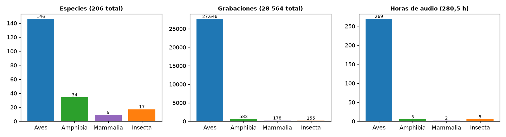

---

## 3. Etiquetas, volumen y duración

### 3.1 Distribución por especie (cola larga)

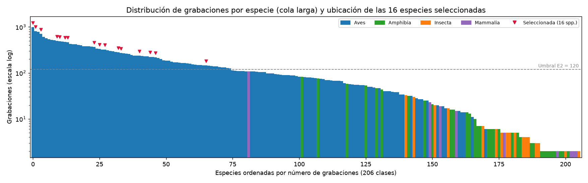

- Media 138,7 grabaciones/especie, mediana 80,5, mínimo 2 y máximo 990 (`grekis`, Great Kiskadee).
- **Las no-aves son casi inexistentes en entrenamiento:** 60 especies suman solo 916 grabaciones (3,2 %). Mediana por especie: anfibios 6, insectos 5, mamíferos 5. 39 especies tienen < 10 grabaciones.
- Las especies no-aves que más grabaciones tienen (Common Raccoon 108, Túngara Frog 82) tienen 0–1 grabaciones regionales y casi ninguna con rating ≥ 4.

### 3.2 Duración

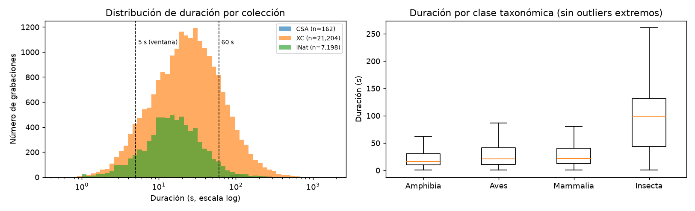

- 2 314 grabaciones (8,1 %) duran < 5 s, que es la longitud de ventana estándar de BirdCLEF → requieren *padding*.
- 139 grabaciones duran > 5 min. Las de CSA son largas (mediana 101 s) e iNat es más corta (15 s) que XC (24 s).
- La etiqueta es **débil a nivel de clip**: no indica en qué segundos vocaliza la especie. En clips largos, muchas ventanas de 5 s no contienen la especie → ruido de etiqueta en el entrenamiento por ventanas.

### 3.3 Calidad y tipo de vocalización

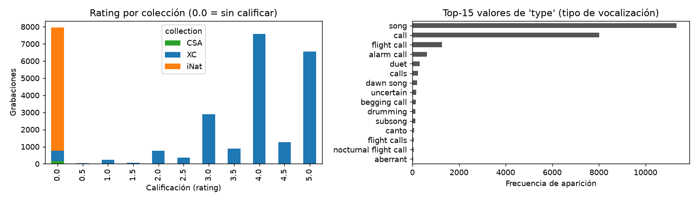

- En XC, el 72,6 % tiene rating ≥ 4. Solo 324 grabaciones XC tienen rating de 0,5 a 1,5.
- iNat no tiene rating ni etiquetas secundarias, así que es una fuente **más ruidosa y con etiquetado incompleto**: otras especies pueden sonar en el audio sin estar anotadas.
- Tipos más frecuentes: `song` 11 328, `call` 8 015, `flight call` 1 264, `alarm call` 620. Puede servir para análisis de errores, no como etiqueta.

---

## 4. Geografía y desplazamiento de dominio

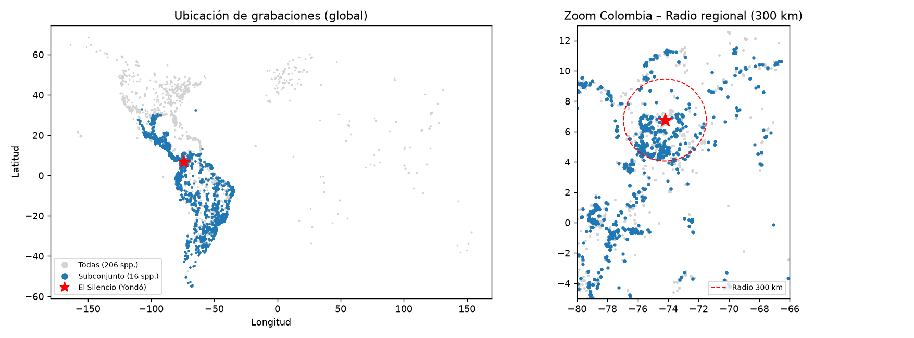
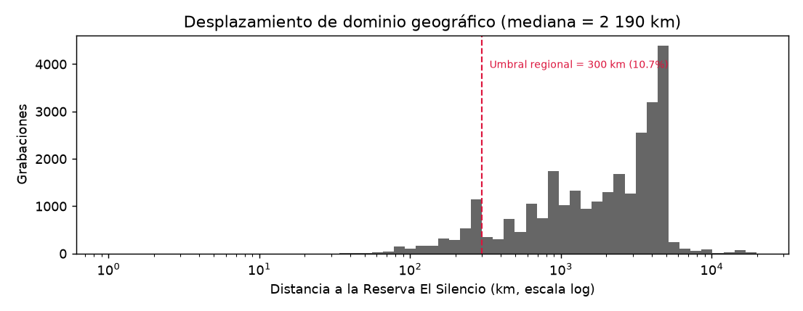

- La mediana de distancia a El Silencio es de **2 190 km**. Muchas especies son de distribución amplia (Neotrópico), así que la mayoría de sus grabaciones proviene de México, Centroamérica, Brasil o Argentina.
- Esto produce un **desplazamiento de dominio** en dialectos, ruido de fondo y equipos de grabación. Además, los audios de entrenamiento (`train_audio`) son focales (micrófono dirigido), mientras que los de evaluación final son paisajes sonoros pasivos (como los de `train_soundscapes`).
- Por eso la evidencia regional (≤ 300 km) es un criterio de selección (E5) y una dimensión de reporte.

### 4.1 Paisajes sonoros locales sin etiquetar (`train_soundscapes`)

Al finalizar la copia de archivos quedó disponible el directorio `train_soundscapes/` con **9 726 grabaciones pasivas** (4,41 GB, **162,1 horas**) tomadas directamente en la Reserva El Silencio. Su nomenclatura sigue el patrón `<SITIO>_<AAAAMMDD>_<HHMMSS>.ogg`:

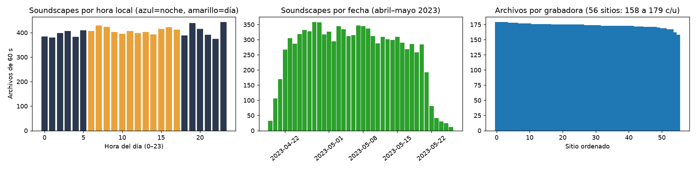
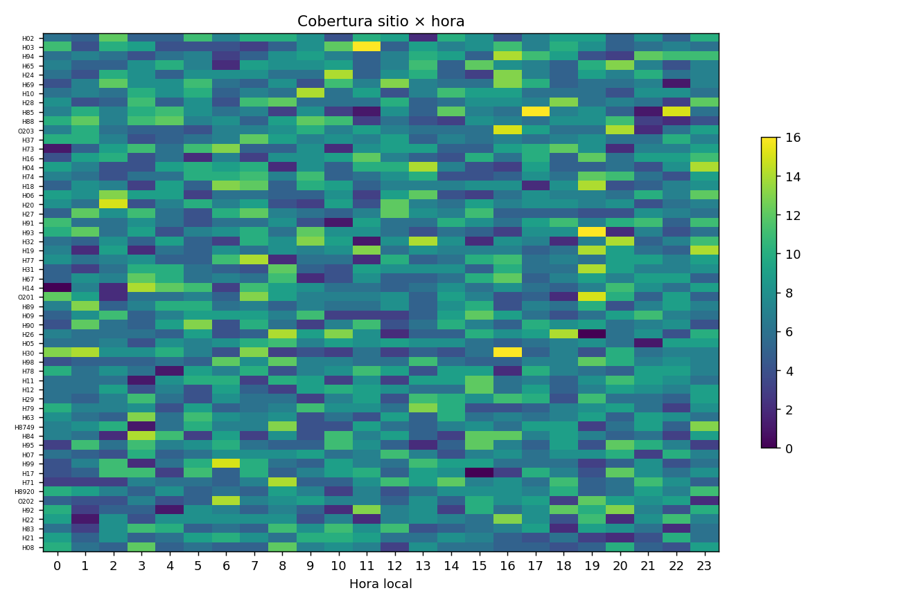

- **Homogeneidad técnica:** 100 % de los archivos duran exactamente **60,0 s** (116 712 ventanas de 5 s), a 32 kHz mono, con cabeceras y bandera `EOS` (*End-Of-Stream*) íntegras.
- **Cobertura espacial y temporal:** **56 sitios/grabadoras** (53 con prefijo `H` —9 206 archivos— y 3 con prefijo `O` —520 archivos—), con una distribución muy uniforme de 158 a 179 archivos por sitio (mediana 174, ~2,9 h/sitio). Cubren **38 días** continuos entre el **19 de abril y el 26 de mayo de 2023**.
- **Ciclo circadiano completo (24 h):** muestreo uniforme en múltiplos de 5 minutos a lo largo de las 24 horas (374 a 443 archivos por hora; **49,5 % nocturnos** entre 18:00 y 06:00). Esto respalda directamente la regla **R2** de incluir especies nocturnas (`trsowl`, `compau`) y crepusculares (`littin1`, `gycwor1`, `laufal1`).
- **Utilidad para los siguientes hitos:** aunque no tienen etiquetas, representan el **dominio acústico exacto de evaluación** (fondo de insectos/anfibios locales, lluvia, respuesta de micrófonos pasivos). Se usarán para: (1) mezcla de ruido de fondo real (*domain-adaptive mixup*), (2) auto-etiquetado (*pseudo-labeling*) y (3) validación cualitativa/inspección por expertos sobre una muestra estratificada por sitio y hora.

---

## 5. Problemas de calidad de datos e integridad detectados

| Problema | Magnitud | Tratamiento propuesto |
|---|---|---|
| Mismo audio iNat asignado a 2 especies (URL duplicada) | 12 URLs / 22 filas (p. ej. `grekis`+`roahaw`, `trsowl`+`compot1`) | Fusionar en **una grabación multietiqueta**. La partición por autor garantiza que ambas copias caigan en el mismo split |
| Rating 0 = "sin calificar", no "malo" | 7 948 filas | No usar `rating` como numérico sin una máscara; nunca excluir por rating = 0 |
| Etiquetas secundarias ausentes en iNat/CSA | 100 % de 7 360 filas | Tratar los negativos de iNat como "inciertos" en un análisis de sensibilidad |
| Clips < 1 s | 24 | Excluir |
| Coordenadas nulas | 809 | Se marcan como no regionales; no afecta la partición |
| `type` en texto libre multilingüe | — | Normalizar solo si se usa para análisis de errores |
| Autores muy prolíficos | En especies raras, un solo autor llega al 100 %; en el subconjunto, máx. 14 % (`rumfly1`, `paltan1`) | Agrupar por autor en todas las particiones |
| Sin bandera `EOS` en `train_audio` | 8 archivos de iNat (3 en el subconjunto: `soulap1`) | Se verificó que su última página OGG está completa (`trailing = 0`) y tienen duración válida (2,0–75,3 s); son cortes de origen en iNat, no corrupción de copia. Se conservan |

---

## 6. Selección de especies del Magdalena Medio

### 6.1 Premisa

Las 206 clases de la competencia fueron definidas para El Silencio, así que **todas son especies del Magdalena Medio** reportadas para el sitio. La selección no busca "qué especies están", sino **cuáles se pueden modelar y evaluar con rigor** y además son ecológicamente representativas del paisaje (bosque húmedo de tierras bajas, ciénagas, potreros ganaderos).

### 6.2 Criterios de elegibilidad (cuantitativos, por especie)

| Id | Criterio | Umbral | Justificación |
|---|---|---|---|
| E1 | Clase taxonómica | Aves | Las no-aves tienen una mediana de 5–6 grabaciones: no se pueden partir en train/val/test agrupados sin quedar con ≤ 1 ejemplo de test |
| E2 | Volumen | ≥ 120 grabaciones | Con ~14 % de test quedan ≥ 18–20 grabaciones de test por especie, el mínimo para estimar AUC/AP por clase con IC razonable |
| E3 | Calidad | ≥ 60 grabaciones con rating ≥ 4 | Asegura un núcleo de ejemplos limpios para entrenamiento y diagnóstico |
| E4 | Diversidad de fuentes | ≥ 40 autores | Permite la partición agrupada por autor sin vaciar ningún fold |
| E5 | Evidencia regional | ≥ 10 grabaciones a ≤ 300 km de El Silencio | Mitiga el desplazamiento de dominio (dialectos y paisaje acústico locales) |

**Embudo de selección** (`tables/selection_funnel.csv`):

| Paso | Especies |
|---|---|
| Total | 206 |
| E1 Aves | 146 |
| + E2 (≥ 120 grabaciones) | 75 |
| + E3 (≥ 60 con rating ≥ 4) | 73 |
| + E4 (≥ 40 autores) | 73 |
| + E5 (≥ 10 regionales) | **57 elegibles** |
| Selección curada (R1–R5) | **16** |

### 6.3 Reglas de selección curada (sobre las 57 elegibles)

- **R1 – Diversidad taxonómica:** máximo 2 especies por familia, para no premiar un modelo que solo distingue Tyrannidae.
- **R2 – Cobertura de gremios ecoacústicos:** que haya especies nocturnas, crepusculares y diurnas, y de los estratos suelo, sotobosque, dosel y áreas abiertas/humedal. Los paisajes sonoros cubren 24 h.
- **R3 – Relevancia regional:** incluir al menos una especie endémica o emblemática del valle del Magdalena.
- **R4 – Dificultad controlada:** incluir al menos 3 pares acústicamente confundibles para medir discriminación fina.
- **R5 – Desempate:** con el mismo gremio, preferir la especie con más grabaciones regionales.

### 6.4 Especies definitivas (16)

| # | Código | Especie | Familia | Actividad | Hábitat / gremio | Grab. incl. | Horas | Regionales | Justificación |
|---|---|---|---|---|---|---|---|---|---|
| 1 | `colcha1` | *Ortalis columbiana* — Colombian Chachalaca | Cracidae | diurna | borde / bosque secundario | 145 | 2,5 | 128 (88 %) | **Endémica de Colombia** (valles del Magdalena y Cauca); emblema regional; coros al amanecer |
| 2 | `littin1` | *Crypturellus soui* — Little Tinamou | Tinamidae | crepuscular | suelo de bosque | 314 | 3,6 | 43 | Estrato terrestre; silbidos tonales al alba y al ocaso |
| 3 | `wbwwre1` | *Henicorhina leucosticta* — White-breasted Wood-Wren | Troglodytidae | diurna | sotobosque húmedo | 497 | 5,3 | 74 | Indicador de bosque; 2.ª especie con más grabaciones regionales |
| 4 | `chbant1` | *Poliocrania exsul* — Chestnut-backed Antbird | Thamnophilidae | diurna | sotobosque húmedo | 270 | 3,2 | 24 | Insectívoro de interior, sensible a la fragmentación |
| 5 | `linwoo1` | *Dryocopus lineatus* — Lineated Woodpecker | Picidae | diurna | borde de bosque | 328 | 2,7 | 30 | Incluye **tamborileo** (señal no vocal) |
| 6 | `orcpar` | *Brotogeris jugularis* — Orange-chinned Parakeet | Psittacidae | diurna | dosel / abierto | 215 | 1,9 | 43 | Llamadas de bandada de banda ancha |
| 7 | `bugtan` | *Thraupis episcopus* — Blue-gray Tanager | Thraupidae | diurna | dosel / borde | 273 | 2,2 | 53 | Par confundible ↔ `paltan1` |
| 8 | `paltan1` | *Thraupis palmarum* — Palm Tanager | Thraupidae | diurna | dosel / palmas | 224 | 2,3 | 33 | Par confundible ↔ `bugtan` (mismo género) |
| 9 | `grekis` | *Pitangus sulphuratus* — Great Kiskadee | Tyrannidae | diurna | abierto / riberas | 982 | 8,2 | 68 | La especie más grabada; ubicua en la región. Par ↔ `rumfly1` |
| 10 | `rumfly1` | *Myiozetetes cayanensis* — Rusty-margined Flycatcher | Tyrannidae | diurna | borde cerca de agua | 236 | 2,0 | 48 | Vocalizaciones tipo *kiskadee*; par ↔ `grekis` |
| 11 | `roahaw` | *Rupornis magnirostris* — Roadside Hawk | Accipitridae | diurna | borde / abierto | 701 | 7,7 | **104** | Rapaz más común; la especie con más grabaciones regionales |
| 12 | `laufal1` | *Herpetotheres cachinnans* — Laughing Falcon | Falconidae | crepuscular/diurna | borde de bosque | 460 | 7,0 | 39 | Duetos largos audibles a gran distancia |
| 13 | `soulap1` | *Vanellus chilensis* — Southern Lapwing | Charadriidae | diurna/nocturna | potreros / ciénagas | 483 | 3,2 | 63 | Paisaje ganadero y humedal del Magdalena Medio |
| 14 | `gycwor1` | *Aramides cajaneus* — Gray-cowled Wood-Rail | Rallidae | crepuscular | humedal / ribereño | 365 | 5,1 | 30 | Coros fuertes al crepúsculo; par ↔ `colcha1` |
| 15 | `trsowl` | *Megascops choliba* — Tropical Screech-Owl | Strigidae | **nocturna** | borde / abierto | 464 | 5,6 | 63 | Gremio nocturno; par ↔ `compau` |
| 16 | `compau` | *Nyctidromus albicollis* — Common Pauraque | Caprimulgidae | **nocturna** | abierto / borde | 802 | 9,0 | 52 | Chotacabras nocturno muy común |

**Pares confundibles (R4):** `grekis`↔`rumfly1`, `bugtan`↔`paltan1`, `colcha1`↔`gycwor1`, `trsowl`↔`compau`.
**Cobertura (R2):** 2 nocturnas, 4 crepusculares o mixtas, 10 diurnas. Estratos: suelo (1), sotobosque (2), borde/dosel (8), abierto/humedal (5).

> [!NOTE]
> **Especies relevantes descartadas y por qué:**
> - *Crax alberti* (Blue-billed Curassow, en peligro crítico y emblema de El Silencio): solo 20 grabaciones (falla E2).
> - Tropical Kingbird, Boat-billed Flycatcher y otros Tyrannidae elegibles: los excluye R1 (ya hay 2 Tyrannidae).
> - Common Potoo: elegible, pero el gremio nocturno ya está cubierto y el 55 % de sus grabaciones son de iNat (sin rating ni secundarias). Además, comparte un audio duplicado con `trsowl`.
> - Todas las no-aves: fallan E1/E2 (ver §3.1). El pool completo de 57 elegibles está en `tables/eligible_pool.csv`, por si se quiere sustituir alguna especie con los mismos criterios.

### 6.5 Distribución y desbalance del subconjunto

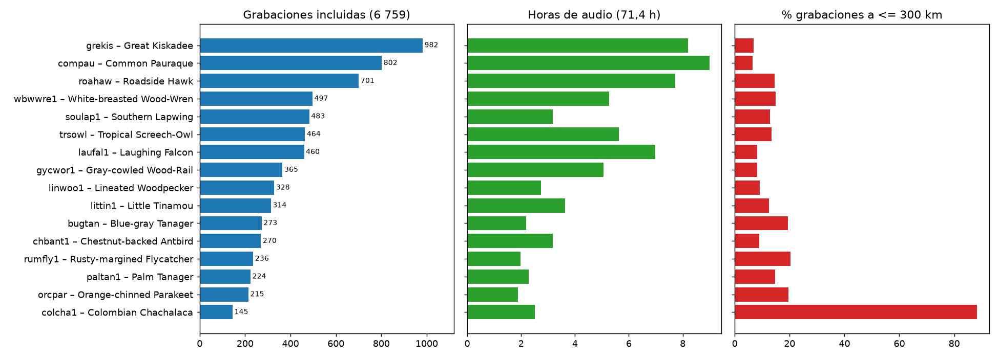

- **Ratio máx/mín 6,8:1** (`grekis` 982 vs `colcha1` 145), Gini 0,28. Es mucho menor que el 495:1 del dataset completo, pero sigue siendo relevante: las 3 especies mayores suman el 37 % de las grabaciones.
- En **horas** el desbalance es parecido (1,9 h `orcpar` – 9,0 h `compau`). En **ventanas de 5 s** hay 48 491 en total.
- **El grado de regionalidad está desbalanceado:** `colcha1` tiene un 88 % de grabaciones locales, mientras que `grekis` y `compau` tienen < 7 %. Un modelo podría aprender un "sesgo de canal" (equipos y ruido de fondo colombianos) como atajo para `colcha1`. Hay que vigilarlo en el análisis de errores.
- Mitigaciones previstas para la fase de modelado: pesos por clase inversos a la frecuencia (columna `weight_inv_freq` en `data_derived/subset_species.csv`, de 0,43 a 2,91), muestreo balanceado por época y métricas *macro* (todas las clases pesan igual).

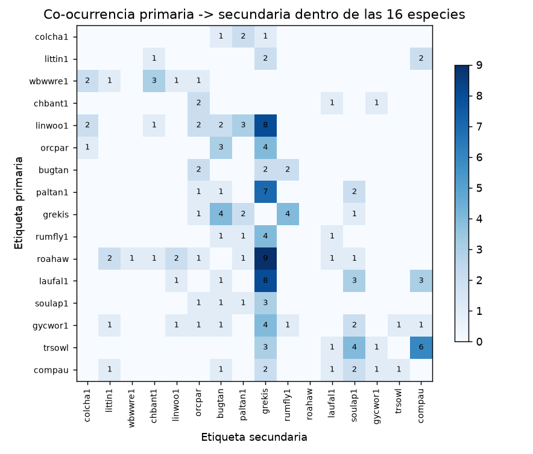

- El 2,2 % de las grabaciones del subconjunto es multietiqueta dentro de las 16 especies. `grekis` es el "fondo" más frecuente: aparece como secundaria en grabaciones de `roahaw`, `linwoo1`, `laufal1` y `paltan1`. `trsowl` y `compau` co-ocurren (6 casos), lo que confirma su solapamiento ecológico nocturno.

---

## 7. Criterios de inclusión a nivel de grabación

| Criterio | Regla | Excluidas |
|---|---|---|
| I1 | `primary_label` ∈ subconjunto | 6 821 candidatas |
| I2 | Duración ≥ 1 s | 4 |
| I3 | Si `collection == XC`: rating ≥ 2 (rating 0 = sin calificar, se conserva) | 57 |
| I4 | Audios duplicados (misma URL) → 1 sola fila multietiqueta | 1 fusión (`grekis`+`roahaw`) |
| I5 | Etiquetas = primaria ∪ secundarias que pertenezcan al subconjunto | — |
| **Resultado** | | **6 759 grabaciones** |

Salida: `data_derived/subset_recordings.csv` (columnas `labels`, `split`, `regional`, `dist_km`, etc.).

---

## 8. Protocolo de evaluación

### 8.1 Tarea

Clasificación **multietiqueta** de 16 especies. El modelo produce una probabilidad independiente (sigmoide) por especie para cada **ventana de 5 s**, igual que el formato de BirdCLEF. Como en `train_audio` las etiquetas son a nivel de clip, la evaluación en este hito es **a nivel de grabación**: la puntuación del clip es el **máximo** sobre sus ventanas, y la media se reporta como análisis de sensibilidad. Se usan todas las ventanas del clip, y los clips < 5 s se rellenan (*padding*).

### 8.2 Particiones (fijas y versionadas)

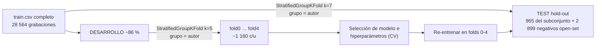

- **Agrupación por autor:** ningún autor aparece en dos particiones (verificado con un `assert` en el script). Así se evita la fuga por un mismo recordista, equipo, sitio o individuo, y por los audios duplicados de iNat.
- **Estratificación** por especie. Las grabaciones de las otras 190 especies se estratifican como `__other__`, de modo que la partición de todo `train.csv` sirve también para la evaluación *open-set*.
- **Resultado:** test 965 (14,3 %), con un **mínimo de 20 grabaciones de test por especie** (`colcha1`) y un máximo de 137 (`grekis`). Los folds tienen 1 153–1 163 grabaciones cada uno.
- El test **se usa una sola vez**, con el modelo final. Toda decisión (arquitectura, umbrales, aumentos) se toma con las predicciones fuera de fold (OOF) de la CV.
- Archivos: `data_derived/subset_recordings.csv` y `data_derived/split_all_recordings.csv` (columna `split`).

### 8.3 Métricas

| Rol | Métrica | Motivo |
|---|---|---|
| **Principal** | **Macro ROC-AUC** (omitiendo clases sin positivos) | Métrica oficial de BirdCLEF 2025; no depende del umbral; macro = todas las especies pesan igual |
| Secundaria | **cmAP** (macro average precision) | Más sensible al desbalance y a los falsos positivos que el AUC |
| Secundaria | **Macro-F1**, precisión y recall por especie | Necesitan umbral: se calibra un umbral por especie sobre las OOF de la CV y se aplica fijo al test |
| Secundaria | **Balanced accuracy / top-1** sobre la etiqueta primaria | Vista monoetiqueta interpretable |
| Diagnóstico | Matriz de confusión y **tasa de confusión de los 4 pares** de §6.4 | Mide la discriminación fina |
| Diagnóstico | **Open-set:** tasa de falsos positivos sobre 2 899 grabaciones de test de especies fuera del subconjunto (sin secundarias del subconjunto), y AUROC "subconjunto vs otras" usando el score máximo | Simula los paisajes sonoros, donde la mayoría de los sonidos no son de las 16 especies |
| Diagnóstico | Calibración (ECE, Brier) | Necesaria si las probabilidades se usarán para umbralizar en campo |

**Cortes (*slices*) de reporte:** por especie; por colección (XC 708 / iNat 257 en test); regional ≤ 300 km (134 en test, solo agregado porque hay 1–19 por especie); por actividad (nocturna, crepuscular, diurna).

### 8.4 Etiquetas para la evaluación

- **Principal:** vector multietiqueta = primaria ∪ secundarias del subconjunto.
- **Sensibilidad:** en las grabaciones iNat/CSA (sin anotación de secundarias), excluir los negativos del cálculo, por si ocultan presencias reales.

### 8.5 Reporte estadístico

- En CV: media ± desviación estándar de los 5 folds.
- En test: estimación puntual + **IC 95 % por bootstrap** (1 000 remuestreos **por autor**, que respeta la dependencia dentro de cada grupo).
- Para comparar modelos: bootstrap pareado sobre test, o Wilcoxon sobre los folds. Una mejora se considera significativa si el IC de la diferencia excluye 0.
- **Baselines mínimos** para el siguiente hito: (a) clasificador de prior constante (AUC = 0,5); (b) embeddings preentrenados (BirdNET/Perch) + regresión logística; (c) CNN sobre log-mel.

---

## 9. Limitaciones y riesgos

1. **Los paisajes sonoros locales (`train_soundscapes`) no tienen etiquetas:** `test_soundscapes/` está vacío y los 9 726 archivos de `train_soundscapes/` (162,1 h de El Silencio) no están anotados. La evaluación cuantitativa sobre grabaciones focales (`train_audio`) es una **cota superior optimista** del rendimiento en campo. Para cerrar esta brecha se recomienda: (a) usar `train_soundscapes` para evaluar la distribución de predicciones y tasa de activación por hora del día (coherencia ecológica diurna vs. nocturna), y (b) anotar manualmente un pequeño conjunto de validación de dominio (p. ej. 50–100 ventanas de 5 s estratificadas por sitio y hora).
2. **Etiquetas débiles:** la etiqueta en `train_audio` es del clip completo, no de la ventana de 5 s.
3. **Etiquetado incompleto en iNat** (sin secundarias): genera falsos negativos en el ground truth.
4. **Sesgo geográfico:** 87 % de las grabaciones focales del subconjunto son de fuera de la región.
5. El subconjunto deja fuera anfibios e insectos, que son muy abundantes en el fondo de `train_soundscapes`. Es una decisión de factibilidad estadística en `train_audio`, no de relevancia ecológica.

---

## 10. Artefactos generados en la estructura del repositorio MIAA

| Ruta | Contenido |
|---|---|
| [`notebooks/hito1_eda_seleccion_especies.ipynb`](../notebooks/hito1_eda_seleccion_especies.ipynb) | **Jupyter Notebook único y 100 % autocontenido del Hito 1** (con todo el código Python explícito y comentado línea por línea de EDA, selección y particionamiento, narrativa Markdown, tablas HTML y gráficas embebidas) |
| [`src/utils/helpers.py`](../src/utils/helpers.py) | Funciones auxiliares compartidas y documentadas (`ogg_header_info`, `batch_ogg_header_info`, `parse_list_field`, `haversine_km`, `gini_coefficient`, `parse_soundscape_filename`, `print_header`) |
| [`src/data/audio_loader.py`](../src/data/audio_loader.py) | Carga de `train.csv`, `taxonomy.csv`, rutas de audio y extracción de duraciones OGG |
| [`src/data/preprocess.py`](../src/data/preprocess.py) | Criterios E1–E5, curación R1–R5, filtrado I1–I5 y partición estratificada agrupada por autor |
| [`src/evaluation/metrics.py`](../src/evaluation/metrics.py) | Cálculo de Macro ROC-AUC, Macro-F1, cmAP, precisión, recall y métricas por especie |
| [`src/training/preprocessing/`](../src/training/preprocessing/) | Scripts modulares de apoyo (`ogg_durations.py`, `hito1_eda.py`, `soundscapes_eda.py`, `build_hito1_notebook.py`) |
| `src/data/processed/train_durations.csv` | Duración, sample rate, canales y tamaño por archivo de `train_audio` |
| `src/data/processed/train_soundscapes_meta.csv` | Sitio, fecha, hora, duración e integridad de los 9 726 paisajes sonoros |
| `src/data/processed/subset_species.csv` | 16 especies con métricas, justificación, conteos por split y pesos `weight_inv_freq` |
| `src/data/processed/subset_recordings.csv` | 6 759 grabaciones incluidas con `labels` y `split` (`fold0`..`fold4`, `test`) |
| `src/data/processed/split_all_recordings.csv` | Partición de las 28 564 grabaciones (para open-set) |
| `experiments/results/hito1/tables/*.csv` | `species_summary_all.csv`, `eligible_pool.csv`, `selection_funnel.csv`, `soundscapes_by_site.csv`, `collection_summary.csv`, `top_types.csv`, `subset_cooccurrence.csv` |
| `experiments/results/hito1/stats.json`, `soundscapes_stats.json` | Todas las cifras citadas |
| `experiments/results/hito1/figures/01…11_*.png` | Figuras (01–09 `train_audio`, 10–11 `train_soundscapes`) |
