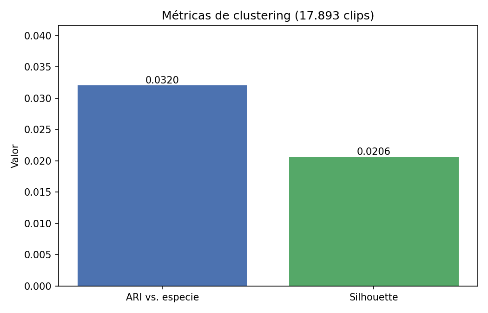
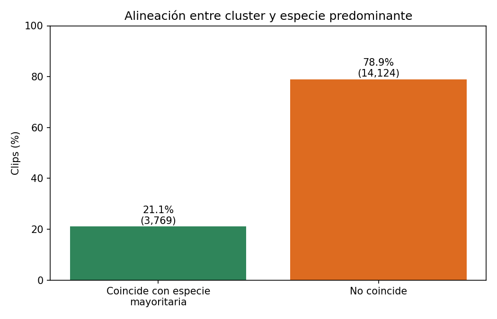
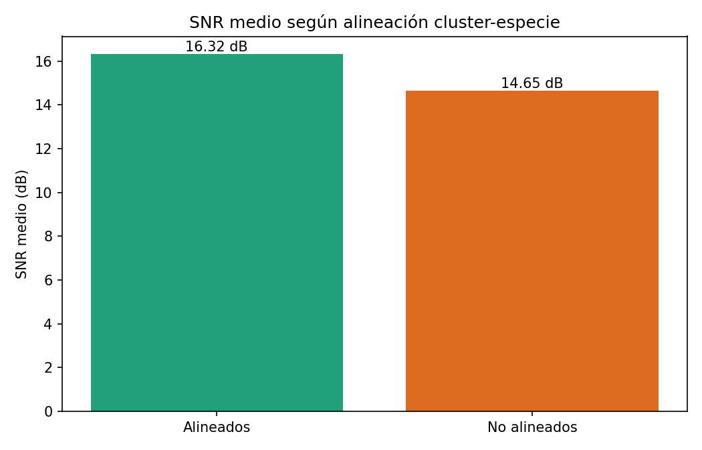
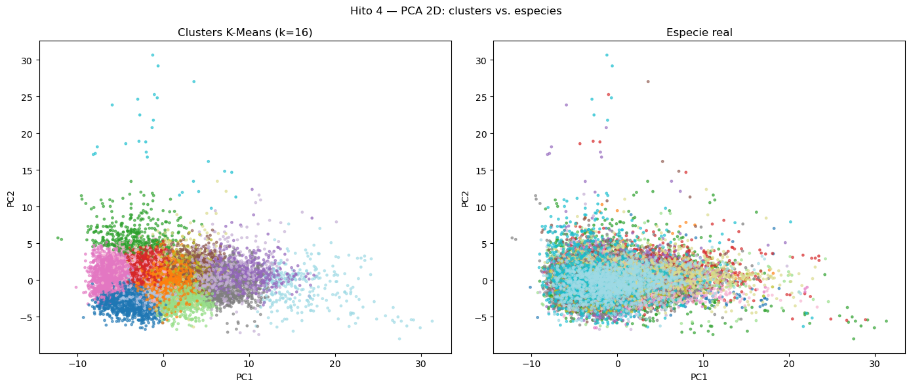
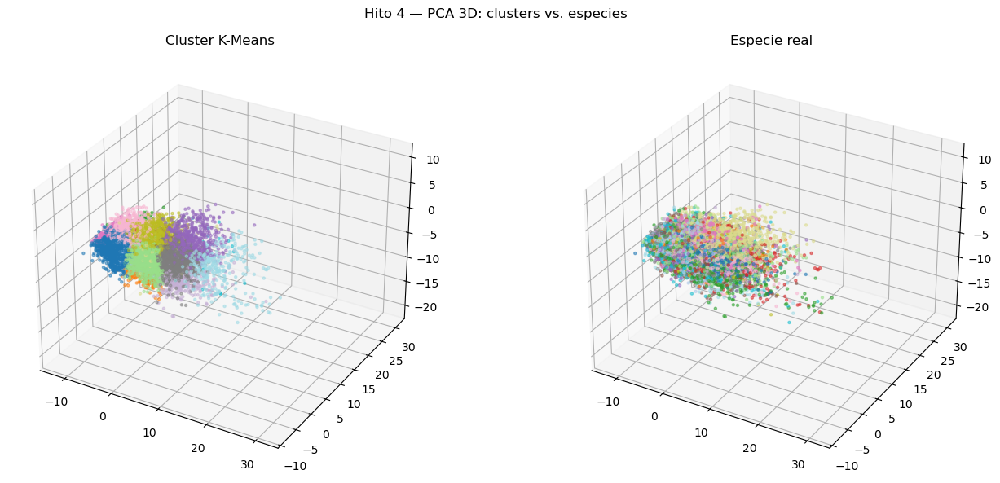
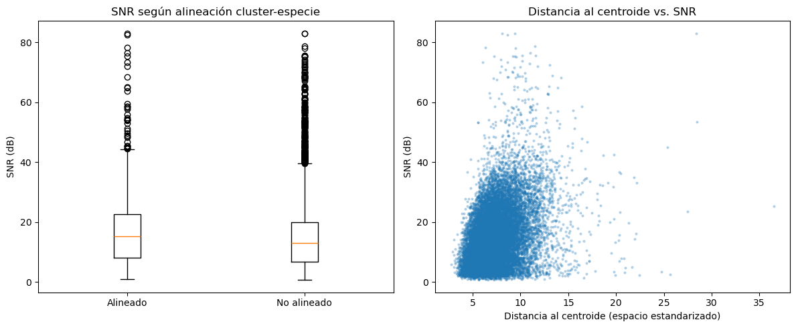
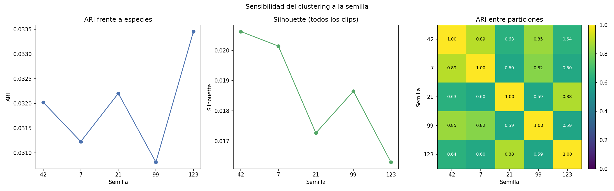

# Hito 4 — Clustering exploratorio (K-Means) sobre las características acústicas

**Proyecto 1 de Innovación Tecnológica — Maestría en Inteligencia Artificial Aplicada (MIAA)**
**Universidad Icesi · Cali, Colombia**
**Responsables del Hito 4:** Juan Fernando Gutiérrez · Miguel Ángel Paz
**Equipo:** Juan Fernando Gutiérrez · Miguel Ángel Paz · Carlos Alberto Salamando · Verónica Serna
**Notebook ejecutable:** [`notebooks/hito4_clustering.ipynb`](../notebooks/hito4_clustering.ipynb)
**Módulos de producción:** [`src/training/hito4_clustering.py`](../src/training/hito4_clustering.py) · [`src/main.py`](../src/main.py)

**Estado:** 🟢 **Ejecutado y validado.** Resultados y figuras corresponden a la ejecución del notebook sobre `train` + `val`, con `test` excluido.

---

## 1. Objetivo y alcance

Explorar, de forma **no supervisada**, si las 90 características acústicas calculadas en el Hito 3 agrupan los clips de 5 s de forma consistente con las 16 especies reales del subconjunto Magdalena Medio — sin usar las etiquetas para entrenar el agrupamiento, solo para evaluarlo después.

El Hito 4 **no** entrena un clasificador ni decide el modelo final; es un diagnóstico exploratorio de la separabilidad del espacio de características, y una primera mirada a si el ruido de fondo (calidad del clip) distorsiona esa separación.

## 2. Entradas heredadas del Hito 3

- `src/data/features/features.csv`: 20 748 clips × 90 columnas acústicas + metadatos (`primary_label`, `author`, `recording_id`, `split`, `partition`, `snr_db`, `dbfs`, `inband_energy_ratio`, `activity_score`, `quality_tier`).
- El escalador se ajusta con las filas `train` de las 90 características y transforma `train` + `val`. Para las proyecciones, PCA también se ajusta con `train` estandarizado y se aplica a `train` + `val`.
- Se excluye la partición `test` de todo el análisis exploratorio (solo se usa `train` + `val`, es decir `partition != "test"`).

## 3. Metodología ejecutada

### 3.1. Agrupamiento K-Means

- Algoritmo: `sklearn.cluster.KMeans`, `n_clusters = 16` (igual al número de especies del subconjunto), `n_init = 10` y `random_state = 42` para la corrida principal.
- Variables de entrada: las 90 características estandarizadas con un `StandardScaler` ajustado solo con `train` (no se usa la etiqueta en ningún momento del ajuste).
- Para evaluar la sensibilidad a la inicialización, se repitió el ajuste con las semillas 42, 7, 21, 99 y 123, manteniendo fijos los datos, el escalado, *k* y `n_init`.

### 3.2. Proyecciones 2D/3D

- Se ajusta un PCA de tres componentes con el conjunto `train` estandarizado y se proyectan todos los clips `train` + `val`.
- Dos vistas lado a lado de la misma proyección: coloreada por **cluster asignado** y coloreada por **especie real (`primary_label`)**.

### 3.3. Métricas de calidad del agrupamiento

| Métrica | Qué mide | Librería |
|---|---|---|
| **Silhouette Score** | Cohesión interna de cada cluster vs. separación entre clusters (no usa etiquetas reales) | `sklearn.metrics.silhouette_score` |
| **ARI (Adjusted Rand Index)** | Coincidencia entre la partición de K-Means y las especies reales, ajustado por azar | `sklearn.metrics.adjusted_rand_score` |

### 3.4. Relación con el ruido de fondo

Con las métricas por clip del Hito 2/3 (`snr_db` e `inband_energy_ratio`), se comparó el SNR medio de clips alineados/no alineados con la especie mayoritaria del cluster y se calculó la correlación de Spearman entre distancia al centroide y ambas métricas. La alineación es descriptiva; no se usa para ajustar K-Means.

## 4. Salidas

La ejecución guarda `clustering_metrics.json` y `cluster_assignments.csv` en `experiments/results/hito4_5/clustering/`. Las figuras incluidas en este reporte están en `docs/assets/hito4/` para que no dependan de archivos derivados excluidos del control de versiones.

- Las proyecciones PCA 2D/3D y la gráfica de distancia/SNR se exportaron desde las salidas de imagen del notebook.
- Las gráficas de métricas, alineación, SNR y estabilidad se generaron a partir del `clustering_metrics.json` de esta ejecución.

## 5. Resultados

**Ejecución completa sobre los 17 893 clips de `train`+`val` (sin `test`), semilla 42.**

| Indicador | Valor |
|---|---:|
| Adjusted Rand Index (cluster K-Means vs. especie real) | **0,0320** |
| Silhouette Score (todos los 17 893 clips) | **0,0206** |
| Clips alineados con la especie mayoritaria de su cluster | 3 769 / 17 893 (21,1 %) |
| Varianza explicada PCA (PC1, PC2, PC3) | 25,9 % · 5,9 % · 4,8 % |
| SNR medio — clips alineados | 16,32 dB |
| SNR medio — clips no alineados | 14,65 dB |
| Spearman(distancia al centroide, `snr_db`) | ρ = 0,348 (p-value subdesbordado a 0 por precisión numérica) |
| Spearman(distancia al centroide, `inband_energy_ratio`) | ρ = 0,271 (p = 6,24×10⁻²⁹⁸) |

### Estabilidad de K-Means ante la semilla

Se repitió el ajuste con semillas 42, 7, 21, 99 y 123, manteniendo fijos los datos, el escalado, `k=16` y `n_init=10`. Tanto ARI como Silhouette se calcularon para los mismos **17 893 clips** en cada corrida (no se tomó submuestra).

| Semilla | ARI vs. especie | Silhouette (todos los clips) |
|---:|---:|---:|
| 42 | 0,0320 | 0,0206 |
| 7 | 0,0312 | 0,0201 |
| 21 | 0,0322 | 0,0173 |
| 99 | 0,0308 | 0,0186 |
| 123 | 0,0335 | 0,0163 |

El ARI entre pares de particiones varió entre **0,590 y 0,891**. Esto indica que las soluciones tienen acuerdo parcial, pero las asignaciones no son idénticas entre inicializaciones.

**Lectura de los resultados:**

- El **ARI es bajo (0,0320)** y el **Silhouette es cercano a cero (0,0206)**: la partición de K-Means muestra poca concordancia con las especies y escasa separación entre clusters en las 90 características estandarizadas.
- El **21,1 %** de los clips coincide con la especie mayoritaria de su cluster (3 769 de 17 893); esta proporción es descriptiva y no sustituye al ARI.
- La distancia al centroide presenta asociaciones positivas con `snr_db` (ρ = 0,348) e `inband_energy_ratio` (ρ = 0,271). La media de SNR es 16,32 dB entre los clips alineados y 14,65 dB entre los no alineados. Son estadísticas distintas: no se concluye que una distancia mayor implique menor SNR ni que el ruido cause la baja calidad del clustering.
- Las tres componentes PCA explican **36,7 %** de la varianza (25,9 % + 5,9 % + 4,8 %). PCA se usa únicamente para visualizar; K-Means opera sobre las 90 características, por lo que las proyecciones 2D/3D son una vista parcial y no miden por sí solas la separabilidad en el espacio original.
- La evaluación con cinco semillas mantiene bajo el ARI frente a especies (0,0308–0,0335), mientras el acuerdo entre particiones (ARI 0,590–0,891) muestra sensibilidad moderada a la inicialización.
- **Importante:** un ARI/Silhouette bajos en clustering no supervisado **no implica** que las mismas features sean inútiles para clasificación supervisada (Hito 5) — K-Means ignora las etiquetas por completo, mientras que SVM/baseline las usan directamente para encontrar fronteras de decisión específicas por especie. Los resultados del Hito 5 (ver `hito5_baseline_svm_report.md`) muestran, de hecho, que el mismo espacio de features sí permite un desempeño supervisado considerablemente por encima del azar.

## 6. Evidencia gráfica

Las imágenes de esta sección se basan en las salidas de la ejecución actual del notebook y en sus métricas guardadas. Se mantienen en `docs/assets/hito4/` para que las referencias del reporte funcionen también al compartir el repositorio.

### 6.1. Métricas de clustering

**Figura 6.1.** ARI = 0,0320 frente a especies y Silhouette = 0,0206 sobre los 17 893 clips. Ambos valores respaldan la baja concordancia externa y la escasa separación interna.

### 6.2. Coincidencia con la especie mayoritaria

**Figura 6.2.** 3 769 clips (21,1 %) coinciden con la especie mayoritaria asignada a su cluster; 14 124 (78,9 %) no coinciden.

### 6.3. SNR según alineación

**Figura 6.3.** El SNR medio fue 16,32 dB para clips alineados y 14,65 dB para los no alineados. Esta comparación por grupos no debe confundirse con la correlación positiva entre distancia al centroide y SNR.

### 6.4. Proyecciones PCA

**Figura 6.4.** Proyección de los dos primeros componentes: a la izquierda, clusters K-Means; a la derecha, especies reales. El solapamiento visual es consistente con las métricas, aunque la figura solo representa parte de la variación.

**Figura 6.5.** Vista de los tres primeros componentes, que explican conjuntamente 36,7 % de la varianza.

### 6.5. Distancia al centroide y SNR

**Figura 6.6.** La correlación de Spearman entre distancia al centroide y SNR es positiva (ρ = 0,348). El gráfico es descriptivo y no demuestra que la calidad del audio cause la asignación del cluster.

### 6.6. Estabilidad ante la semilla

**Figura 6.7.** ARI frente a especies y Silhouette calculados sobre todos los clips para cada semilla; el mapa de calor muestra ARI entre pares de particiones (la diagonal es 1 por comparar cada solución consigo misma).

No se incluye el dendrograma ilustrativo de versiones anteriores: no forma parte del flujo actual del notebook ni sustenta estos resultados.

Las asignaciones por clip (`cluster_assignments.csv`) y métricas (`clustering_metrics.json`) se guardan en `experiments/results/hito4_5/clustering/`.

## 7. Limitaciones y advertencias

- K-Means usa distancia euclidiana y favorece grupos aproximadamente compactos; este supuesto puede no representar la variación acústica de las especies. Además, `k=16` se fijó por el número de especies, no porque se haya demostrado que sea el número óptimo de clusters.
- Un ARI/Silhouette bajo en clustering no supervisado no demuestra que las características sean inútiles para clasificación supervisada: el clustering no usa las etiquetas para ajustar fronteras. Ver resultados del [Hito 5](hito5_baseline_svm_report.md).
- El conjunto `test` se excluyó. La evaluación cubre `train` + `val`, y `primary_label` solo se utiliza después del ajuste para calcular ARI y alineación.
- Las correlaciones y diferencias de medias son descriptivas; no establecen causalidad entre el ruido y el resultado del clustering.
- Este hito es exploratorio/complementario según el plan de trabajo; si el tiempo es limitado, se prioriza el flujo baseline → SVM → evaluación sobre profundizar en clustering.
