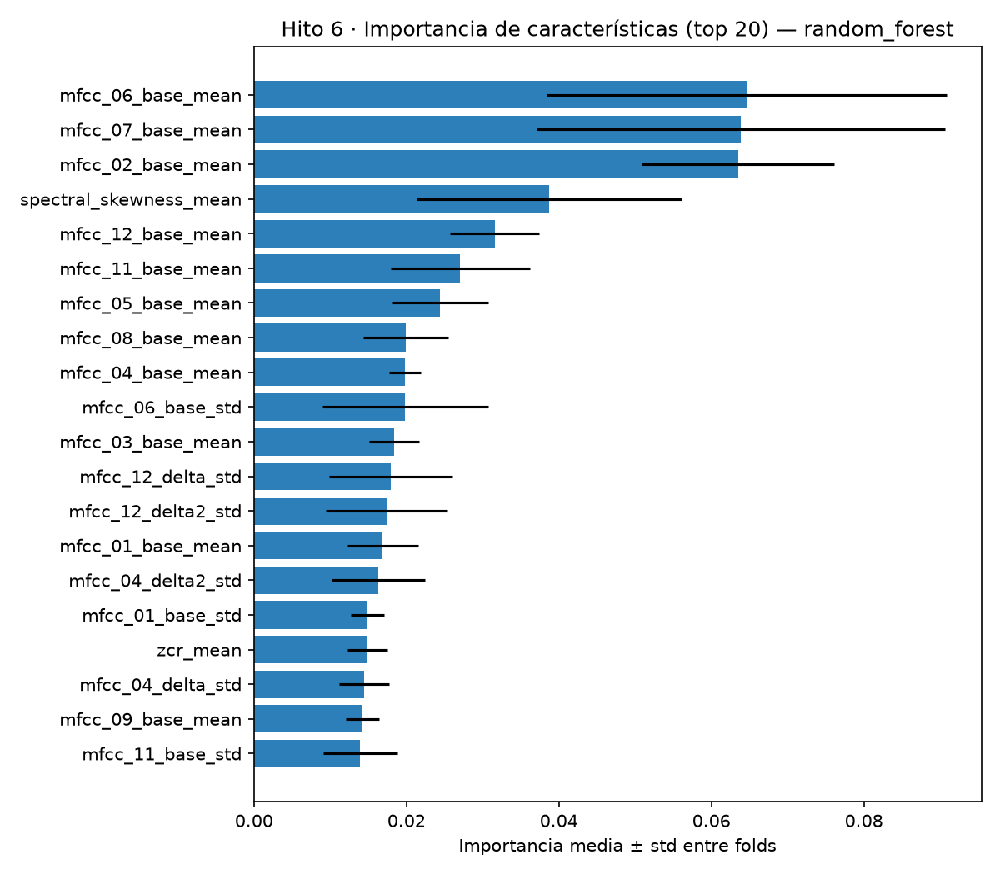
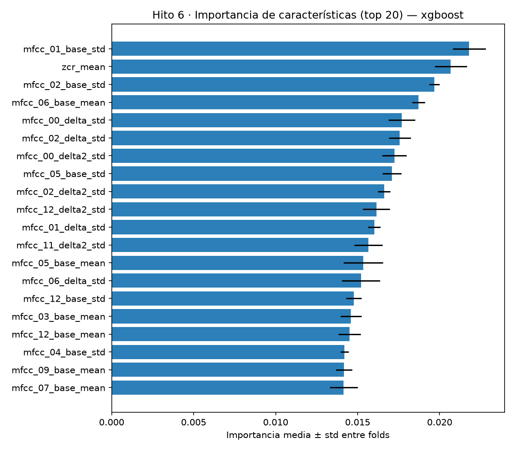

# Hito 6 — Random Forest y XGBoost: metodología y desarrollo completo

**Proyecto 1 de Innovación Tecnológica — Maestría en Inteligencia Artificial Aplicada (MIAA)**
**Universidad Icesi · Cali, Colombia**
**Responsables según plan:** Carlos Alberto Salamando · Verónica Serna
**Equipo:** Juan Fernando Gutiérrez · Miguel Ángel Paz · Carlos Alberto Salamando · Verónica Serna

**Estado:** 🟢 **Ejecutado** (21 de noviembre de 2026) — CV externa de 5 folds agrupados por autor, búsqueda interna GroupKFold(3) por autor, semilla 42, test excluido.

> Documento autocontenido: describe de inicio a fin qué se hizo, por qué y con qué resultado, sin necesidad de leer otros archivos del repositorio.

---

## 1. Punto de partida: qué existía antes de este hito

| Insumo (hitos previos) | Descripción |
|---|---|
| `src/data/features/features.csv` (Hito 3) | 20.748 clips × 90 características acústicas: MFCC (media, std, delta, delta-delta) y estadísticos espectrales (centroide, ancho de banda, roll-off, ZCR, asimetría, curtosis). |
| Particiones fijadas (Hitos 1–2) | `train` 14.296 clips (fold0–3), `val` 3.597 (fold4), `test` 2.855. Agrupadas por grabación y autor: ninguna grabación se reparte entre particiones. |
| Línea base (Hito 5) | SVM RBF: **Macro-F1 0,466 ± 0,019**, Macro ROC-AUC 0,908 ± 0,004 (CV de 5 folds, umbral de decisión 0 en `decision_function`). |
| Retroalimentación del evaluador | Reportar intervalos de confianza o pruebas pareadas, no solo media ± desviación; analizar umbrales de decisión. |

## 2. Objetivo

Entrenar y comparar **Random Forest** y **XGBoost** sobre las 90 características, con búsqueda de hiperparámetros **dentro** de la validación cruzada, contrastarlos contra la línea base SVM RBF, calcular importancia de características y seleccionar el modelo para la evaluación final **usando solo validación** (`test` excluido en todo el hito).

## 3. Metodología paso a paso

### 3.1 Tarea y etiquetas

Clasificación **multietiqueta** de 16 especies: una especie vale 1 si aparece en `primary_label` o en `secondary` del clip. Los scores de clips de una misma grabación se agregan tomando el **máximo por especie** antes de evaluar (la unidad de decisión es la grabación, no el clip).

### 3.2 Validación cruzada externa sin fuga

- 5 folds agrupados por autor (`fold0`–`fold4`, ya fijados; no se recombinan).
- En cada iteración un fold completo se reserva para validación y los otros 4 entrenan.
- El `StandardScaler` se reajusta **solo con el entrenamiento del fold** y luego transforma validación (los árboles no lo requieren; se conserva por comparabilidad con Hito 5).

### 3.3 Búsqueda de hiperparámetros dentro de la CV

`RandomizedSearchCV` con **12 candidatos** por modelo y por fold, con validación interna **GroupKFold(3) agrupada por autor** calculada solo sobre el entrenamiento del fold. La validación externa nunca participa del ajuste — así la búsqueda no introduce fuga.

| Modelo | Espacio de búsqueda |
|---|---|
| Random Forest | `n_estimators` ∈ {200, 400, 600}; `max_depth` ∈ {None, 10, 20, 30}; `min_samples_leaf` ∈ {1, 2, 5}; `max_features` ∈ {sqrt, log2, 0.3}; `class_weight` ∈ {balanced, balanced_subsample} |
| XGBoost (OvR) | `n_estimators` ∈ {300, 600, 900}; `max_depth` ∈ {4, 6, 8, 10}; `learning_rate` ∈ {0.03, 0.05, 0.1}; `subsample` ∈ {0.7, 0.8, 1.0}; `colsample_bytree` ∈ {0.5, 0.7, 1.0}; `min_child_weight` ∈ {1, 5, 10}; `scale_pos_weight` ∈ {1, 3, 10} |

XGBoost usa `tree_method="hist"` en GPU (CUDA) si está disponible, con respaldo automático a CPU (`--device auto|cuda|cpu`; resultados idénticos, solo cambia el tiempo).

### 3.4 Umbral de decisión

Umbral fijo **0,5** en la comparación principal (idéntico al Hito 5, sin grados de libertad extra). El ajuste de umbral por especie se estudia aparte como análisis de sensibilidad (sección 4.3) y culminó en la decisión de umbrales out-of-fold (sección 4.4).

### 3.5 Sobre SMOTE

El plan contempla SMOTE solo si las métricas lo justifican. La línea base mostró recall macro 0,60–0,88 sin colapso por clase, por lo que no se aplicó; un remuestreo multietiqueta correcto (por salida OvR dentro del fold) queda como trabajo condicional.

### 3.6 Métricas y contraste estadístico

- Macro-F1, precisión macro, recall macro, Macro ROC-AUC, exact-match y cmAP: promedio ± desviación entre los 5 folds.
- **IC 95 %** por métrica (t de Student, n = 5; orientativo).
- **Wilcoxon pareado** del Macro-F1 por fold contra SVM RBF (n = 5: el menor p alcanzable es 0,0625; evidencia de dirección, no concluyente).

## 4. Resultados

### 4.1 Tabla comparativa (umbral fijo 0,5; 17.893 clips train+val; semilla 42)

| Modelo | Macro-F1 [IC95] | Macro ROC-AUC [IC95] | Precisión macro | Recall macro |
|---|---|---|---|---|
| Baseline logreg (H5) | 0,299 ± 0,007 | 0,894 ± 0,005 | 0,185 | 0,883 |
| SVM RBF (H5) | 0,466 ± 0,019 | 0,908 ± 0,004 | 0,343 | 0,765 |
| Random Forest | 0,200 [0,188; 0,211] | 0,888 [0,883; 0,893] | 0,84 | 0,12 |
| **XGBoost** | **0,536 [0,506; 0,567]** | **0,908 [0,905; 0,912]** | — | — |

**Wilcoxon pareado vs. SVM RBF:**

| Comparación | ΔF1 por fold | ΔF1 medio | p |
|---|---|---:|---:|
| XGBoost − SVM RBF | +0,068 · +0,082 · +0,052 · +0,097 · +0,055 | **+0,071** | 0,0625 |
| Random Forest − SVM RBF | −0,253 · −0,281 · −0,289 · −0,261 · −0,246 | −0,266 | 0,0625 |

### 4.2 Lectura

- **XGBoost es el nuevo mejor modelo:** supera a SVM RBF en Macro-F1 en los 5/5 folds con igual ROC-AUC (0,908). Sus mejores hiperparámetros convergen a un modelo conservador y regularizado: `learning_rate` 0,05, `max_depth` 4, `n_estimators` 300, `subsample` 0,7, `colsample_bytree` 0,5, `scale_pos_weight` 10.
- **El F1 bajo de Random Forest es un artefacto del umbral 0,5**, no del ranking: precisión 0,79–0,91 con recall 0,11–0,13 y ROC-AUC 0,888. Sus probabilidades (votos de árboles) son conservadoras y rara vez superan 0,5 con prevalencias de ~10 %.

### 4.3 Sensibilidad de umbral (ajuste por especie dentro de cada fold)

Eligiendo el umbral por especie que maximiza F1 sobre el propio fold de validación (sin test):

| Modelo | Macro-F1 (umbral 0,5) | Macro-F1 (umbral ajustado) |
|---|---:|---:|
| Random Forest | 0,200 ± 0,009 | **0,547 ± 0,014** |
| XGBoost | 0,536 ± 0,022 | **0,610 ± 0,009** |

Con umbral ajustado ambos ensambles superan a SVM RBF (0,466): la calibración de umbrales quedó confirmada como palanca de desempeño.

### 4.4 Umbrales out-of-fold (OOF): corrección del sobreajuste de umbrales

**Problema detectado después (21-nov).** La primera evaluación final ajustó umbrales solo sobre fold4 y rumfly1 recibió umbral 0,30 → 111 falsos positivos en test. Se reconstruyeron las predicciones out-of-fold de los 5 folds de este hito (17.893 clips, 5.794 grabaciones — cada clip validado exactamente una vez, sin test) y se reajustaron los umbrales:

| Criterio | Macro-F1 en validación |
|---|---:|
| Umbral ajustado solo en fold4 | 0,570 |
| **Umbral ajustado out-of-fold (5 folds)** | **0,593** |

6 de 16 especies cambiaron su umbral en más de 0,10 (rumfly1 0,30 → 0,55; soulap1 0,61 → 0,83; roahaw 0,56 → 0,74). La segunda pasada por test con umbrales OOF mejoró Macro-F1 de 0,554 a **0,592**, con validación (0,593) ≈ test (0,592): sin brecha de generalización. La decisión, sus salvaguardas y ambos resultados quedaron documentados en el informe final (sección 3.4) y en `docs/decision_umbrales_oof.md`.

### 4.5 Importancia de características

Top por importancia media entre folds:

| Random Forest | % | XGBoost | % |
|---|---:|---|---:|
| mfcc_06_base_mean | 6,5 | mfcc_01_base_std | 2,2 |
| mfcc_07_base_mean | 6,4 | zcr_mean | 2,1 |
| mfcc_02_base_mean | 6,4 | mfcc_02_base_std | 2,0 |
| spectral_skewness_mean | 3,9 | mfcc_06_base_mean | 1,9 |
| mfcc_12_base_mean | 3,2 | mfcc_00_delta_std | 1,8 |

Los MFCC de orden bajo y medio dominan (rol de timbre espectral), junto a variabilidad temporal (delta/delta-delta std) y ZCR. XGBoost reparte la importancia más uniformemente (máx. ~2 %) que Random Forest (máx. ~6,5 %).





## 5. Reproducibilidad

```bash
uv sync --group notebook --group dev          # entorno (Python 3.13)
uv run python src/main.py --stage hito6       # corrida completa (2–3 h; --device cpu sin GPU)
uv run python scripts/hito6_threshold_analysis.py   # sensibilidad de umbral por fold
uv run python scripts/hito6_oof_thresholds.py       # umbrales out-of-fold
uv run python -m pytest tests/ -q             # 15 pruebas (incluye las del hito 6)
```

Notebook ejecutado con salidas embebidas: `notebooks/hito6_ensembles.ipynb` (lee los artefactos ya generados; no repite la corrida completa).

## 6. Artefactos

Todo en `experiments/results/hito6/`:

- `cv_scores_by_fold.csv` — una fila por (modelo, fold) con métricas y tiempos.
- `cv_summary.json` — resumen con IC95 y configuración.
- `per_class_metrics.csv` — F1 por especie por fold.
- `feature_importance.csv` — importancia por característica, modelo y fold.
- `paired_tests_vs_hito5.json` — Wilcoxon contra la línea base.
- `config.json` — espacios de búsqueda, semilla y mejores hiperparámetros por fold.
- `threshold_sensitivity.json` — umbrales por especie ajustados por fold.
- `oof_thresholds.json` — umbrales out-of-fold y comparación contra fold4.
- `artifacts/*.joblib` — mejor modelo de cada fold (~840 MB; no se versionan, se regeneran).
- `figures/feature_importance_*.png`.

## 7. Limitaciones

- Búsqueda aleatoria de 12 candidatos: no garantiza el óptimo del espacio; documenta un punto de partida sólido, no el mejor modelo posible.
- IC con t de Student (n = 5) y Wilcoxon (n = 5) tienen potencia baja: evidencia orientativa, como pidió el evaluador, sin convertirla en prueba concluyente.
- El umbral fijo 0,5 en la tabla principal mantiene comparabilidad con H5 pero deja desempeño sobre la mesa (cuantificado en 4.3–4.4).
- Ningún resultado de este hito usa `test`; la selección final se confirmó una única vez en la evaluación final (Macro-F1 0,592, ROC-AUC 0,915).
