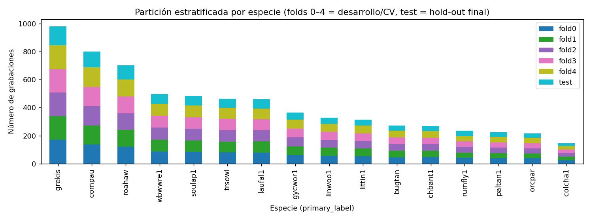
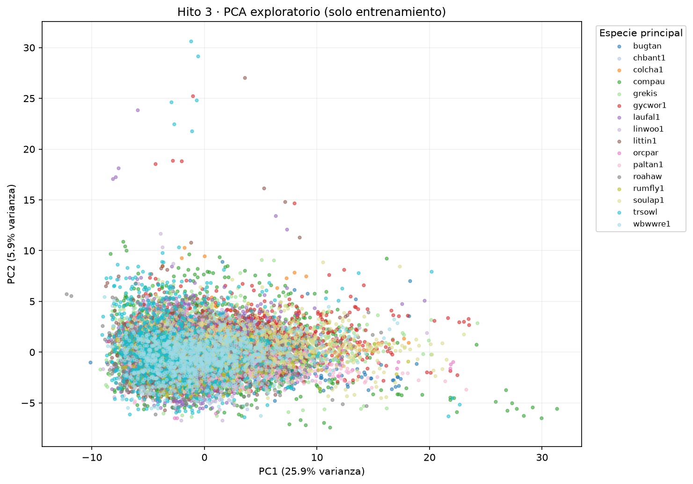
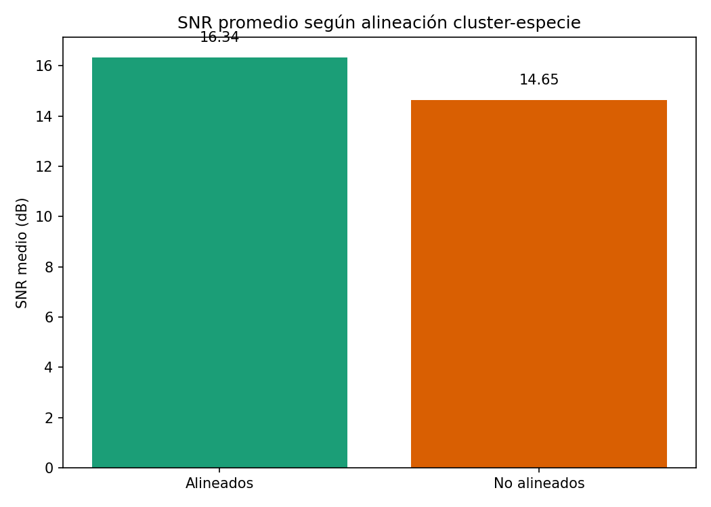
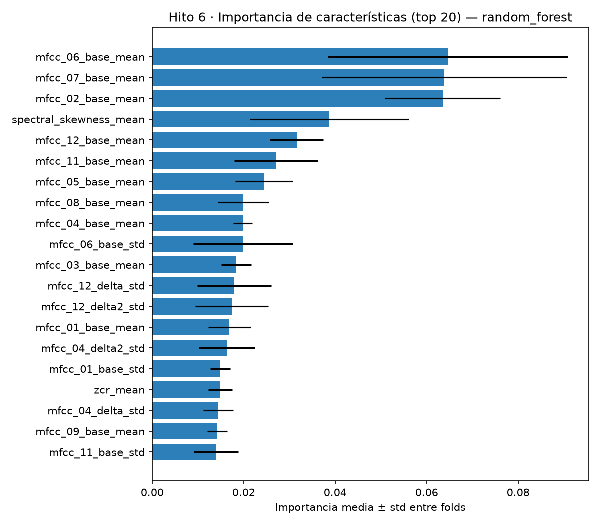
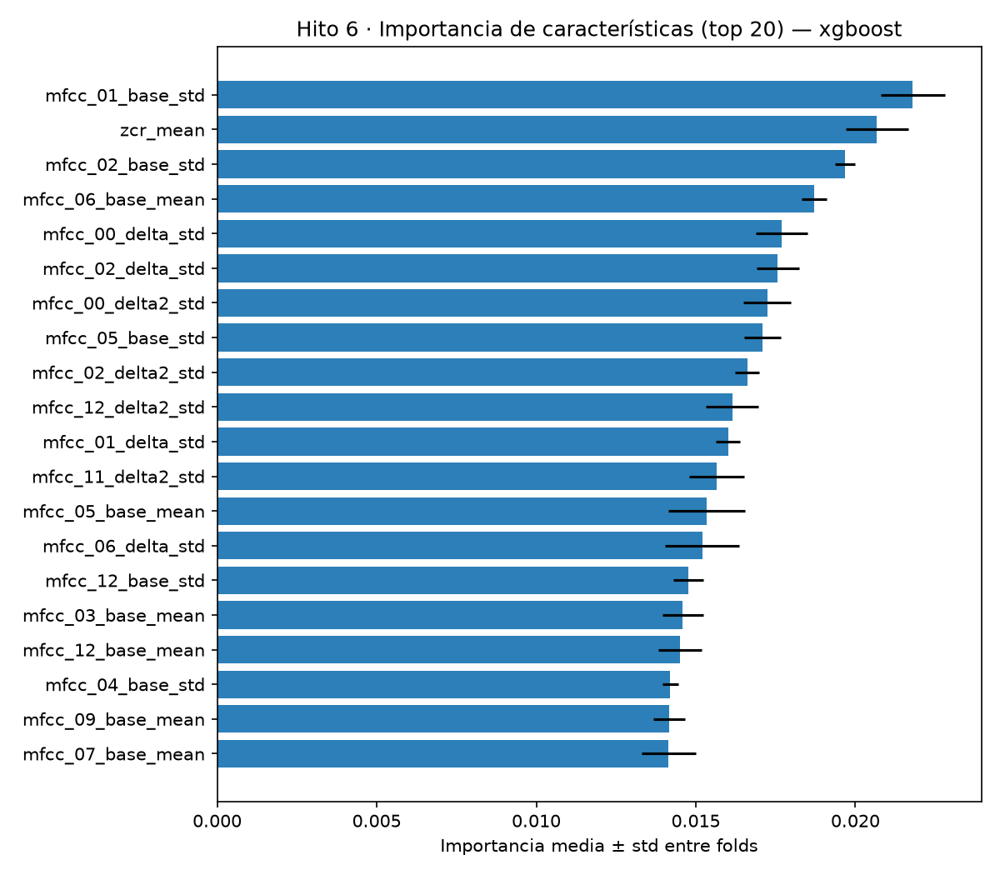

# Identificación multietiqueta de 16 especies de aves del Magdalena Medio a partir de características acústicas clásicas

**Proyecto 1 de Innovación Tecnológica — Maestría en Inteligencia Artificial Aplicada (MIAA), Universidad Icesi, Cali, Colombia**

Juan Fernando Gutiérrez, Miguel Ángel Paz, Carlos Alberto Salamando, Verónica Serna

---

**Resumen** — Este trabajo presenta el desarrollo y la validación de un prototipo reproducible de clasificación automática multietiqueta para identificar 16 especies de aves del Valle del Magdalena Medio (Colombia) a partir de clips de audio de 5 segundos de la competencia BirdCLEF+ 2025. Se extrajeron 90 características acústicas por clip (coeficientes cepstrales en frecuencias de Mel con sus derivadas temporales y estadísticos espectrales) y se compararon una línea base logística, máquinas de soporte vectorial y ensambles de árboles (Random Forest y XGBoost) bajo un protocolo estricto de validación cruzada de 5 folds agrupados por autor, con búsqueda de hiperparámetros anidada y umbrales de decisión por especie calibrados con predicciones out-of-fold. El modelo final (XGBoost) alcanzó en la evaluación única sobre el conjunto de prueba una Macro-F1 de 0,592, Macro ROC-AUC de 0,915 y CMAP de 0,637, sin brecha entre validación y prueba. Las tres hipótesis del proyecto quedaron apoyadas: las características clásicas contienen señal predictiva, los ensambles superan a la línea base y el ruido de fondo explica una parte medible del error (los clips con errores tienen SNR mediano 5,76 dB menor).

**Índice de Términos** — aprendizaje automático, bioacústica, clasificación multietiqueta, conservación, MFCC, monitoreo acústico pasivo, XGBoost.

## I. INTRODUCCIÓN

El monitoreo acústico pasivo (PAM) permite registrar el ambiente sonoro de forma continua y no invasiva, y se ha convertido en una herramienta clave para la conservación: las vocalizaciones de las aves sirven como indicador de presencia, actividad y salud de los ecosistemas. En el Magdalena Medio colombiano —una de las regiones con mayor riqueza de aves del país y bajo fuerte presión ambiental— identificar automáticamente especies por su canto habilita monitoreo a escala que el trabajo de campo manual no puede cubrir.

**Objetivo general:** desarrollar y validar, entre el 13 de octubre y el 30 de noviembre de 2026, un prototipo reproducible de clasificación automática multietiqueta y exploración acústica para identificar un subconjunto de 10 a 20 especies de fauna del Valle del Magdalena Medio a partir de clips cortos de audio de BirdCLEF+ 2025, usando descriptores espectrales y cepstrales (MFCC y estadísticas de espectrogramas) y comparando modelos SVM y ensambles. El desempeño se evalúa con métricas globales y por especie, sin comprometer de antemano un puntaje mínimo.

**Objetivos específicos:**

1. Construir un pipeline reproducible de acondicionamiento (32 kHz, clips de 5 s, filtrado pasa-banda) y compensación de desbalance, con particionado estratificado.
2. Extraer un vector de descriptores por clip (MFCC, derivadas temporales, estadísticos espectrales) y caracterizar la separabilidad natural de los sonotipos con clustering y reducción de dimensionalidad.
3. Entrenar y comparar SVM y ensambles (Random Forest, XGBoost) con validación cruzada agrupada, reportando Macro-F1, Macro ROC-AUC y métricas por especie, y documentar el impacto del ruido y la brecha entre grabaciones focales (Xeno-Canto) y de campo (soundscapes).

**Estado del arte.** Las soluciones competitivas en BirdCLEF+ 2025 combinan aumento de datos, modelos sobre espectrogramas Mel y ensambles, con un tope reportado de ROC-AUC 0,930 [1]. El aprendizaje profundo sobre espectrogramas (BirdNET, una ResNet de 157 capas para 984 especies de Norteamérica y Europa [4]) muestra la utilidad de la aumentación específica del dominio frente a ruido y solapamiento, pero no ha sido evaluado en el Magdalena Medio. El aprendizaje clásico sobre descriptores acústicos (SVM con parámetros mel-cepstrales [3]; ensambles de redes y descriptores para audio animal [5]) permite comparaciones controladas y reproducibles en subconjuntos acotados. El clustering no supervisado de sonotipos [8] respalda la exploración sin etiquetas de la separabilidad acústica. La colección de sonidos ambientales del Instituto Humboldt, fuente primaria de BirdCLEF+ 2025, documenta las particularidades bioacústicas colombianas: saturación del espectro por insectos, alta proporción de especies raras y brecha entre grabaciones de museo y muestreo pasivo [7].

## II. MATERIALES Y MÉTODOS

### A. Datos y subconjunto de especies

Se utilizaron los datos de BirdCLEF+ 2025 [1]: grabaciones focales de Xeno-Canto y soundscapes de campo del Magdalena Medio (Reserva Natural El Silencio y humedales de Barbacoas). Se seleccionaron 16 especies por disponibilidad de datos y relevancia de conservación: bugtan, chbant1, colcha1, compau, grekis, gycwor1, laufal1, linwoo1, littin1, orcpar, paltan1, roahaw, rumfly1, soulap1, trsowl, wbwwre1. El acondicionamiento estandarizó el audio a 32 kHz, aplicó un filtro pasa-banda Butterworth de orden 4 (150 Hz–14 kHz, fase cero) y segmentó en clips de 5 s, conservando en promedio el 78,65 % de la energía en banda vocal. El conjunto final tiene 20.748 clips: 14.296 de entrenamiento (folds 0–3), 3.597 de validación (fold4) y 2.855 de prueba, con particiones **agrupadas por grabación y autor** (ninguna grabación se reparte entre particiones). La partición de prueba permaneció intacta hasta la evaluación final.

### B. Características acústicas

Se extrajeron 90 características por clip: coeficientes MFCC (media, desviación estándar, delta y delta-delta) y estadísticos espectrales (centroide, ancho de banda, roll-off, tasa de cruces por cero, asimetría y curtosis). El escalador estándar se ajustó únicamente con datos de entrenamiento dentro de cada fold y luego transformó validación.

### C. Protocolo experimental

La tarea es multietiqueta: una especie vale 1 si aparece como etiqueta primaria o secundaria del clip; los scores de clips de una misma grabación se agregan por máximo por especie antes de evaluar. Se empleó validación cruzada de 5 folds agrupados por autor con semilla 42. La búsqueda de hiperparámetros (búsqueda aleatoria, 12 candidatos) se ejecutó **dentro** de cada fold con validación interna de 3 grupos por autor, de modo que la validación externa nunca participó del ajuste. Los umbrales de decisión por especie se eligieron maximizando F1 sobre las predicciones **out-of-fold** de los 5 folds (17.893 clips validados cada uno exactamente una vez), tras documentarse el sobreajuste de ajustarlos sobre un único fold. El modelo final se reentrenó sobre entrenamiento+validación con hiperparámetros congelados (configuración modal de los 5 folds) y se evaluó **una sola vez** en prueba. Se reportan intervalos de confianza del 95 % (t de Student, 5 folds) y la prueba pareada de Wilcoxon. Entorno: Python 3.13, scikit-learn, XGBoost [2], Librosa; gestor de entorno `uv`; 15 pruebas automatizadas; GPU opcional (resultados idénticos en CPU).

### D. Hipótesis y criterios de contraste

Las hipótesis se formularon a posteriori de la línea base pero **a priori de la evaluación en prueba**, con criterios de apoyo fijos.

**Tabla I. Hipótesis: criterio propuesto vs. valor obtenido**

| Hipótesis | Criterio de apoyo propuesto | Valor obtenido | Veredicto |
|---|---|---|---|
| **H1.** Las características acústicas clásicas contienen señal predictiva de especie | Macro ROC-AUC con IC95 > 0,5; F1 > 0 en ≥ 12 de 16 especies | ROC-AUC prueba = 0,915 (CV: 0,908 [0,905–0,912]); F1 > 0 en 16/16 especies | Apoyada |
| **H2.** Los ensambles de árboles superan a la línea base SVM RBF | Δ Macro-F1 > 0 entre folds y Wilcoxon p < 0,10 | XGBoost − SVM RBF: ΔF1 = +0,071 (5/5 folds), Wilcoxon p = 0,0625 | Apoyada (XGBoost) |
| **H3.** El ruido de fondo degrada la estructura del espacio de características | (a) Spearman ρ > 0 significativo entre distancia al centroide y SNR; (b) SNR mediano de errores < aciertos en prueba (IC95 bootstrap excluye 0) | (a) ρ = 0,348, p ≈ 0; (b) errores 10,73 dB vs. aciertos 16,50 dB; diferencia −5,76 dB [−6,73, −4,57] | Apoyada |

## III. RESULTADOS

### A. Exploración y línea base

El análisis exploratorio documentó la distribución y el desbalance de las 16 especies y fijó las particiones agrupadas por autor (Fig. 1). La proyección PCA del espacio de 90 características es descriptiva y muestra el solapamiento esperado entre especies (Fig. 2). El clustering K-Means obtuvo ARI = 0,032 y Silhouette = 0,021 (baja correspondencia clusters–especies) y una correlación de Spearman ρ = 0,348 (p ≈ 0) entre distancia al centroide del cluster y SNR del clip (Fig. 3). La línea base supervisada (regresión logística y SVM con kernels lineal, RBF y polinomial) tuvo como mejor modelo SVM RBF: Macro-F1 0,466 ± 0,019 y Macro ROC-AUC 0,908 ± 0,004.

Fig. 1. Distribución del subconjunto de 16 especies por partición (train/val/test).

Fig. 2. Proyección PCA 2D del espacio de 90 características (entrenamiento).

Fig. 3. Relación entre SNR del clip y distancia a la estructura de clusters.

### B. Comparación de modelos (validación cruzada, 5 folds)

**Tabla II. Comparación de modelos en validación cruzada (umbral 0,5 salvo indicación)**

| Modelo | Macro-F1 [IC95] | Macro ROC-AUC |
|---|---|---|
| Regresión logística (línea base) | 0,299 ± 0,007 | 0,894 ± 0,005 |
| SVM RBF | 0,466 ± 0,019 | 0,908 ± 0,004 |
| Random Forest (umbral 0,5) | 0,200 [0,188–0,211] | 0,888 |
| Random Forest (umbral por especie) | 0,547 ± 0,014 | 0,888 |
| XGBoost (umbral 0,5) | 0,536 [0,506–0,567] | 0,908 [0,905–0,912] |
| XGBoost (umbral por especie) | 0,610 ± 0,009 | 0,908 |

XGBoost superó a SVM RBF en los 5/5 folds (ΔF1 por fold: +0,068, +0,082, +0,052, +0,097, +0,055; media +0,071; Wilcoxon p = 0,0625, el mínimo alcanzable con n = 5). El F1 bajo de Random Forest con umbral 0,5 es un artefacto del umbral (precisión 0,79–0,91, recall 0,11–0,13, ROC-AUC 0,888), no del ranking. Los mejores hiperparámetros de XGBoost (configuración modal entre folds) fueron: tasa de aprendizaje 0,05, profundidad 4, 300 árboles, submuestreo 0,7, muestreo de columnas 0,5 y peso de clase positiva 10. Las características dominantes en ambos ensambles son los MFCC de orden bajo y medio y la tasa de cruces por cero (Figs. 4 y 5).

Fig. 4. Importancia de características (top) para Random Forest, promedio entre folds.

Fig. 5. Importancia de características (top) para XGBoost, promedio entre folds.

### C. Corrección metodológica: umbrales out-of-fold

La primera evaluación ajustó umbrales solo sobre el fold de validación (3.597 clips) y mostró sobreajuste (una especie recibió umbral 0,30 y produjo 111 falsos positivos en prueba). Con umbrales ajustados sobre predicciones out-of-fold de los 5 folds (17.893 clips, 5.794 grabaciones), la Macro-F1 de validación subió de 0,570 a 0,593 y 6 de 16 especies cambiaron su umbral en más de 0,10.

**Tabla III. Umbrales por especie: fold4 vs. out-of-fold (OOF)**

| Especie | Umbral fold4 | Umbral OOF | | Especie | Umbral fold4 | Umbral OOF |
|---|---:|---:|---|---|---:|---:|
| bugtan | 0,49 | 0,56 | | littin1 | 0,69 | 0,72 |
| chbant1 | 0,54 | 0,72 | | orcpar | 0,63 | 0,71 |
| colcha1 | 0,62 | 0,64 | | paltan1 | 0,51 | 0,51 |
| compau | 0,74 | 0,77 | | roahaw | 0,56 | 0,74 |
| grekis | 0,64 | 0,77 | | rumfly1 | 0,30 | 0,55 |
| gycwor1 | 0,61 | 0,64 | | soulap1 | 0,61 | 0,83 |
| laufal1 | 0,56 | 0,64 | | trsowl | 0,55 | 0,71 |
| linwoo1 | 0,55 | 0,52 | | wbwwre1 | 0,70 | 0,73 |

### D. Evaluación final en prueba (2.855 clips, agregación por grabación)

**Tabla IV. Métricas finales en el conjunto de prueba**

| Métrica | 1ª pasada (umbrales fold4) | Final (umbrales OOF) |
|---|---|---|
| Macro-F1 | 0,554 | **0,592** |
| Precisión macro | 0,488 | 0,598 |
| Recall macro | 0,681 | 0,607 |
| Macro ROC-AUC | 0,915 | 0,915 |
| CMAP (métrica BirdCLEF) | 0,637 | 0,637 |

La estimación de validación (0,593) y el resultado de prueba (0,592) coinciden: no hay brecha de generalización. La Fig. 6 muestra las matrices de confusión por especie.

Fig. 6. Matrices de confusión por especie en el conjunto de prueba (umbrales OOF).

**Tabla V. Resultados por especie en prueba (ordenadas por F1)**

| Especie | Soporte | F1 | Precisión | Recall | | Especie | Soporte | F1 | Precisión | Recall |
|---|---:|---:|---:|---:|---|---|---:|---:|---:|---:|
| compau | 117 | 0,738 | 0,689 | 0,795 | | trsowl | 66 | 0,594 | 0,613 | 0,576 |
| soulap1 | 75 | 0,734 | 0,887 | 0,627 | | grekis | 158 | 0,548 | 0,523 | 0,576 |
| laufal1 | 69 | 0,727 | 0,703 | 0,754 | | roahaw | 99 | 0,531 | 0,509 | 0,556 |
| littin1 | 43 | 0,698 | 0,698 | 0,698 | | paltan1 | 35 | 0,481 | 0,362 | 0,714 |
| gycwor1 | 52 | 0,685 | 0,661 | 0,712 | | bugtan | 43 | 0,472 | 0,397 | 0,581 |
| chbant1 | 38 | 0,649 | 0,667 | 0,632 | | linwoo1 | 46 | 0,455 | 0,418 | 0,500 |
| orcpar | 31 | 0,627 | 0,800 | 0,516 | | rumfly1 | 41 | 0,319 | 0,393 | 0,268 |
| colcha1 | 20 | 0,611 | 0,688 | 0,550 | | wbwwre1 | 70 | 0,605 | 0,561 | 0,657 |

### E. Análisis de errores y ruido

**Tabla VI. SNR de clips con error vs. clips perfectos (prueba)**

| Grupo | n | SNR mediano |
|---|---:|---:|
| Con al menos 1 especie mal clasificada | 1.705 | 10,73 dB |
| Perfectos (16/16 especies correctas) | 1.150 | 16,50 dB |
| Diferencia de medianas (IC95 bootstrap, 10.000 réplicas) | | −5,76 dB [−6,73, −4,57] |

## IV. DISCUSIÓN

Las tres hipótesis quedaron apoyadas. La H1 se confirma en prueba (ROC-AUC 0,915; F1 > 0 en las 16 especies): las características acústicas clásicas contienen señal predictiva consistente. La H2 se confirma para XGBoost, que superó a SVM RBF en todos los folds y en prueba (0,592 vs. 0,466 de la línea base en validación); Random Forest solo la supera con umbral calibrado. La H3 quedó apoyada en ambas partes: el ruido degrada la estructura del espacio (ρ = 0,348) y explica una parte medible del error (los clips con errores tienen SNR mediano 5,76 dB menor).

El desbalance de soporte explica gran parte del error por especie: las especies más difíciles (rumfly1, 41 grabaciones de soporte; linwoo1, 46; bugtan, 43) concentran los F1 más bajos, mientras las mejor representadas (compau, 117; grekis, 158) alcanzan los mejores. El ROC-AUC 0,915 obtenido con características tabulares es comparable con el contexto del tope competitivo de BirdCLEF+ 2025 (0,930) basado en modelos de espectrogramas [1].

Una lección metodológica central: las decisiones de post-procesamiento también se sobreajustan. Toda la mejora de 0,554 a 0,592 provino de cambiar la calibración de umbrales (de un fold a out-of-fold) con los mismos scores. La segunda evaluación de prueba se decidió con evidencia exclusiva de validación, sin búsqueda iterativa sobre prueba, y ambos resultados se reportan con transparencia.

**Limitaciones.** n = 5 folds limita la potencia de las pruebas pareadas (p mínimo 0,0625); los umbrales OOF provienen de modelos de fold aplicados al modelo final (transferencia que empíricamente funcionó: validación 0,593 ≈ prueba 0,592); no se aplicó SMOTE (el recall de la línea base, 0,60–0,88, no mostró colapso); los modelos se entrenaron sobre clips focales (Xeno-Canto) y el despliegue real es sobre soundscapes de campo, con ruido y solapamiento de especies [7].

## V. CONCLUSIONES

1. Las características acústicas clásicas (MFCC y estadísticos espectrales) contienen señal suficiente para identificar las 16 especies con desempeño consistente (ROC-AUC 0,915 en prueba).
2. XGBoost con búsqueda de hiperparámetros dentro de validación cruzada agrupada por autor es el mejor modelo del proyecto: Macro-F1 0,592, ROC-AUC 0,915 y CMAP 0,637 en prueba, sin brecha de generalización (validación 0,593).
3. El protocolo anti-fuga (particiones por grabación y autor, escalado dentro del fold, búsqueda anidada, umbrales out-of-fold, prueba de uso único) produjo estimaciones honestas: la validación predijo el resultado de prueba con error menor a 0,001 de Macro-F1.
4. La calibración de umbrales por especie con criterio explícito (maximizar F1 en validación out-of-fold) aportó una mejora de +0,038 de Macro-F1 sobre el umbral por defecto, sin costo de entrenamiento.
5. Trabajo futuro: remuestreo multietiqueta dentro de folds de entrenamiento, anotación experta de soundscapes y exploración de representaciones de modelos preentrenados de bioacústica [4].

## APÉNDICE

**Reproducibilidad.** Repositorio: github.com/veroserna/Proyecto-1-MIAA. Entorno: `uv sync --group notebook --group dev`. Pipeline por etapas: `uv run python src/main.py --stage hitoN` (N = 1…6) y `--stage evaluacion_final` (añadir `--device cpu` sin GPU). Verificación: `uv run python -m pytest tests/ -q` (15 pruebas). Notebooks ejecutados por hito en `notebooks/`; artefactos en `experiments/results/`. Los modelos del Hito 6 (~840 MB) no se versionan por tamaño y se regeneran con el comando correspondiente.

## RECONOCIMIENTO

Los autores agradecen al instructor Milton Orlando Sarria Paja y a la Maestría en Inteligencia Artificial Aplicada de la Universidad Icesi por el acompañamiento durante el proyecto.

## REFERENCIAS

[1] J. S. Cañas, S. Kahl, T. Denton, M. P. Toro-Gómez, S. Rodriguez-Buritica, J. L. Benavides-Lopez, J. S. Ulloa, P. Caycedo-Rosales, H. Klinck, H. Goëau, W.-P. Vellinga, R. Planqué y A. Joly, “Overview of BirdCLEF+ 2025: Multi-Taxonomic Sound Identification in the Middle Magdalena, Colombia,” *Working Notes of CLEF 2025*, CEUR-WS Vol. 4038, 2025.

[2] T. Chen y C. Guestrin, “XGBoost: A scalable tree boosting system,” en *Proc. 22nd ACM SIGKDD Int. Conf. Knowledge Discovery and Data Mining*, 2016, pp. 785–794. doi: 10.1145/2939672.2939785.

[3] S. Fagerlund, “Bird Species Recognition Using Support Vector Machines,” *EURASIP Journal on Advances in Signal Processing*, vol. 2007, no. 1, 2007. doi: 10.1155/2007/38637.

[4] S. Kahl, C. M. Wood, M. Eibl y H. Klinck, “BirdNET: A deep learning solution for avian diversity monitoring,” *Ecological Informatics*, vol. 61, 101236, 2021. doi: 10.1016/j.ecoinf.2021.101236.

[5] L. Nanni, Y. M. G. Costa, R. L. Aguiar, R. B. Mangolin, S. Brahnam y C. N. Silla, “Ensemble of convolutional neural networks to improve animal audio classification,” *EURASIP Journal on Audio, Speech, and Music Processing*, vol. 2020, no. 1, 2020. doi: 10.1186/s13636-020-00175-3.

[6] F. Pedregosa et al., “Scikit-learn: Machine learning in Python,” *Journal of Machine Learning Research*, vol. 12, pp. 2825–2830, 2011.

[7] M. P. Toro-Gómez, J. S. Ulloa et al., “Past, present, and future of a tropical sounds collection from Colombia,” *Bioacoustics*, vol. 32, no. 4, pp. 474–490, 2023.

[8] J. S. Ulloa, T. Aubin, D. Llusia, C. Bouveyron y J. Sueur, “Estimating animal acoustic diversity in tropical environments using unsupervised multiresolution analysis,” *Ecological Indicators*, vol. 90, pp. 346–355, 2018.
