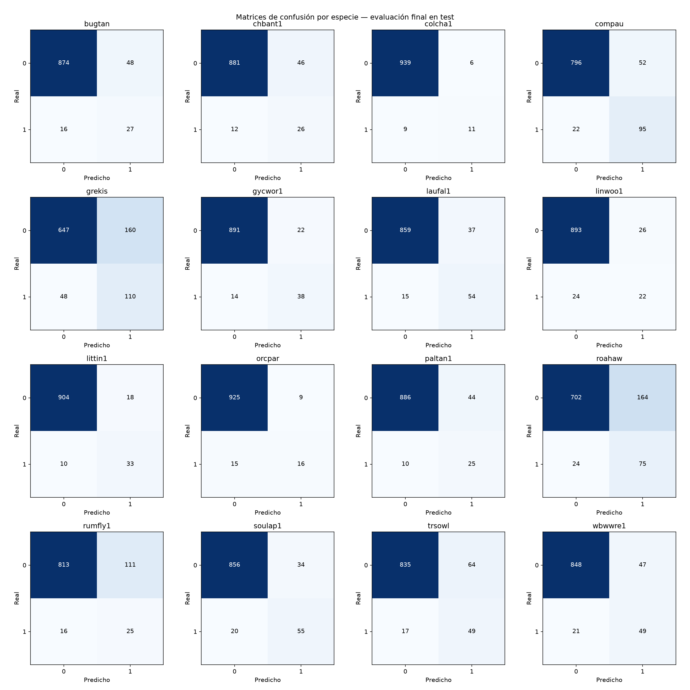

# Informe final — Clasificación multietiqueta de 16 especies de aves del Magdalena Medio (BirdCLEF+ 2025)

**Proyecto 1 de Innovación Tecnológica — Maestría en Inteligencia Artificial Aplicada (MIAA)**
**Universidad Icesi · Cali, Colombia**
**Equipo:** Juan Fernando Gutierrez · Miguel Ángel Paz · Carlos Alberto Salamando · Verónica Serna
**Fecha:** noviembre de 2026

---

## 1. Introducción

El monitoreo acústico pasivo (PAM) permite registrar el ambiente sonoro de forma continua y no invasiva, y se ha convertido en una herramienta clave para la conservación: las vocalizaciones de las aves sirven como indicador de presencia, actividad y salud de los ecosistemas. En el Magdalena Medio colombiano —una de las regiones con mayor riqueza de aves del país y bajo fuerte presión ambiental— identificar automáticamente especies por su canto habilita monitoreo a escala que el trabajo de campo manual no puede cubrir.

**Objetivo general (formulado en la primera entrega):** desarrollar y validar, entre el 13 de octubre y el 30 de noviembre de 2026, un prototipo reproducible de clasificación automática multietiqueta y exploración acústica para identificar un subconjunto de 10 a 20 especies de fauna del Valle del Magdalena Medio a partir de clips cortos de audio de BirdCLEF+ 2025, usando descriptores espectrales y cepstrales (MFCC y estadísticas de espectrogramas) y comparando modelos SVM y ensambles. El desempeño se evalúa con métricas globales y por especie, sin comprometer de antemano un puntaje mínimo.

**Objetivos específicos:**

1. **Preprocesamiento acústico y mitigación del desbalance:** pipeline reproducible de acondicionamiento (32 kHz, clips de 5 s, filtrado pasa-banda) y compensación de desbalance (ponderación de clases o remuestreo), con particionado estratificado.
2. **Ingeniería de características y exploración no supervisada:** vector de descriptores por clip (MFCC, derivadas temporales, estadísticos espectrales) y clustering con reducción de dimensionalidad para caracterizar la separabilidad natural de los sonotipos.
3. **Modelado supervisado, comparación y validación:** entrenar y optimizar SVM y ensambles (Random Forest, XGBoost) con validación cruzada agrupada, reportando Macro-F1, Macro ROC-AUC y métricas por especie, y documentando el impacto del ruido y la brecha entre grabaciones focales (Xeno-Canto) y de campo (soundscapes).

El trabajo se apoya en los datos de la competencia BirdCLEF+ 2025 (grabaciones de Xeno-Canto y soundscapes de campo) y se desarrolló por hitos: análisis exploratorio y selección de especies (H1), acondicionamiento de audio (H2), extracción de características (H3), clustering exploratorio (H4), línea base supervisada (H5), ensambles optimizados (H6) y evaluación final única en test.

### 1.1 Estado del arte (síntesis)

| Enfoque | Representación | Modelos | Ventajas | Limitación frente a este proyecto |
|---|---|---|---|---|
| Aprendizaje profundo sobre espectrogramas (BirdNET) | Espectrogramas de alta resolución temporal | ResNet de 157 capas, 984 especies de Norteamérica/Europa | Aumentación específica del dominio frente a ruido y solapamiento | No evaluado en el Magdalena Medio; su desempeño aquí no es inferible |
| ML clásico sobre descriptores acústicos (**este proyecto**) | Vectores MFCC + estadísticas espectrales | SVM (RBF/polinomial) y ensambles (Random Forest, XGBoost) | Comparable y reproducible en el subconjunto acotado; respaldado por Fagerlund (2007) | La agregación temporal por ventana puede diluir sílabas muy cortas |
| Clustering no supervisado de sonotipos | PCA / UMAP sobre características tiempo-frecuencia | K-Means, DBSCAN | Sin etiquetas; revela separabilidad y clústeres de ruido | No asigna identidades taxonómicas; herramienta diagnóstica |

El tope competitivo de BirdCLEF+ 2025 reporta ROC-AUC de 0,930 con modelos de espectrogramas y ensambles (Cañas et al., 2025) — referencia contextual para el ROC-AUC 0,915 obtenido aquí con características tabulares.

## 2. Metodología

### 2.1 Datos y subconjunto de especies

- **Fuente:** BirdCLEF+ 2025 — grabaciones focales de Xeno-Canto y soundscapes de campo del Magdalena Medio.
- **Subconjunto:** 16 especies seleccionadas por disponibilidad de datos y relevancia de conservación: bugtan, chbant1, colcha1, compau, grekis, gycwor1, laufal1, linwoo1, littin1, orcpar, paltan1, roahaw, rumfly1, soulap1, trsowl, wbwwre1.
- **Acondicionamiento (H2):** audio estandarizado a 32 kHz, filtro pasa-banda, segmentación en clips de 5 s.
- **Particiones:** 20.748 clips — 14.296 train (folds 0–3), 3.597 validación (fold4), 2.855 test. Las particiones se hicieron **agrupadas por grabación y autor**: todos los clips de una misma grabación quedan en la misma partición, eliminando fuga de información entre entrenamiento y evaluación. La partición `test` permaneció intacta hasta la evaluación final.

### 2.2 Características acústicas (H3)

90 características por clip: coeficientes MFCC (media, desviación estándar, delta y delta-delta) y estadísticos espectrales (centroide, ancho de banda, roll-off, ZCR, asimetría y curtosis). El `StandardScaler` se ajusta únicamente con datos de entrenamiento dentro de cada fold y luego transforma validación — regla anti-fuga aplicada en todas las etapas.

### 2.3 Protocolo experimental

- **Tarea multietiqueta:** una especie vale 1 si aparece en `primary_label` o en `secondary`; el vector de etiquetas tiene 16 posiciones.
- **Validación cruzada:** 5 folds agrupados por autor; los scores de clips de una misma grabación se agregan tomando el **máximo por especie** antes de evaluar. Semilla 42 en todos los procesos aleatorios.
- **Búsqueda de hiperparámetros (H6):** `RandomizedSearchCV` con 12 candidatos por modelo, ejecutada **dentro** de cada fold de entrenamiento con validación interna `GroupKFold(3)` por autor — la búsqueda nunca ve el fold de validación externo.
- **Umbrales de decisión:** un umbral por especie, elegido maximizando F1 sobre las predicciones **out-of-fold** de los 5 folds (17.893 clips). La decisión de usar OOF en lugar de un solo fold se documenta en la sección 3.4.
- **Evaluación final:** el modelo final se reentrena sobre train+val con hiperparámetros congelados (configuración modal de los 5 folds) y se evalúa **una sola vez** en test. Los umbrales son post-procesamiento sobre los scores, no parte del entrenamiento.
- **Pruebas estadísticas:** intervalos de confianza del 95 % (t de Student sobre 5 folds) y prueba pareada de Wilcoxon para comparar modelos fold a fold.
- **Reproducibilidad:** pipeline por etapas (`uv run python src/main.py --stage hitoN`), semillas fijas, artefactos versionados, 15 pruebas automatizadas y soporte de GPU opcional (`--device auto|cuda|cpu`; los resultados son idénticos en CPU, solo más lentos).

### 2.4 Hipótesis y criterios de contraste

Las hipótesis se formularon a posteriori del Hito 5 pero **a priori de la evaluación en test**, con criterios de apoyo fijos:

- **H1 — Las características acústicas clásicas contienen señal predictiva de especie.** Criterio: Macro ROC-AUC con límite inferior del IC 95 % por encima de 0,5 (azar), y F1 > 0 en al menos 12 de 16 especies.
- **H2 — Los ensambles de árboles superan a la línea base SVM en este espacio de características.** Criterio: Δ Macro-F1 > 0 entre folds y Wilcoxon pareado p < 0,10 (n = 5, evidencia orientativa), o IC95 sin solapamiento con la línea base.
- **H3 — El ruido de fondo degrada la estructura del espacio de características.** Criterio: correlación de Spearman positiva y significativa entre distancia al centroide del cluster y SNR del clip (exploratorio), y en el análisis de errores final, los clips mal clasificados deberían tener SNR mediano menor que los bien clasificados.

## 3. Resultados

### 3.1 Exploración y línea base (H1, H4, H5)

- El EDA documentó la distribución y el desbalance de las 16 especies y fijó las particiones agrupadas por autor.
- El clustering K-Means (H4) mostró separabilidad parcial del espacio de características y **apoyó la primera parte de H3**: correlación de Spearman ρ = 0,348 (p ≈ 0) entre distancia al centroide del cluster y SNR del clip (ρ = 0,271 para energía en banda): los clips ruidosos se alejan de la región típica de su clase.
- Línea base supervisada (H5, CV 5 folds): regresión logística OvR y SVM (lineal, RBF, polinomial). El mejor fue **SVM RBF: Macro-F1 0,466 ± 0,019, Macro ROC-AUC 0,908 ± 0,004**.

### 3.2 Comparación de modelos — ensambles (H6)

| Modelo | Macro-F1 [IC95] | Macro ROC-AUC |
|---|---|---|
| SVM RBF (H5, línea base) | 0,466 ± 0,019 | 0,908 ± 0,004 |
| Random Forest (umbral 0,5) | 0,200 [0,188–0,211] | 0,888 |
| Random Forest (umbral por especie) | 0,547 ± 0,014 | 0,888 |
| **XGBoost (umbral 0,5)** | **0,536 [0,506–0,567]** | **0,908 [0,905–0,912]** |
| **XGBoost (umbral por especie)** | **0,610 ± 0,009** | 0,908 |

- **XGBoost supera a SVM RBF en los 5/5 folds** (ΔF1 por fold: +0,068, +0,082, +0,052, +0,097, +0,055; media +0,071). Wilcoxon pareado p = 0,0625 — el mínimo alcanzable con n = 5 folds; cumple el criterio de H2 (p < 0,10).
- El Macro-F1 bajo de Random Forest con umbral 0,5 es un **artefacto del umbral**, no del ranking: su precisión era 0,79–0,91 con recall 0,11–0,13, y su ROC-AUC (0,888) muestra que los scores sí ordenan bien. Con umbral por especie sube de 0,200 a 0,547.
- Mejores hiperparámetros de XGBoost (configuración modal entre folds): learning rate 0,05, max_depth 4, n_estimators 300, subsample 0,7, colsample_bytree 0,5, scale_pos_weight 10.

**Contraste de hipótesis en validación:** H1 **apoyada** (ROC-AUC 0,908, IC95 [0,905–0,912] muy por encima del azar; F1 > 0 en las 16 especies) y H2 **apoyada** para XGBoost (ΔF1 > 0 en todos los folds, Wilcoxon p = 0,0625; sin solapamiento de IC95 con la línea base).

### 3.3 Importancia de características

Ambos ensambles concentran la importancia en los MFCC (medias y desviaciones estándar de los primeros coeficientes) y el ZCR:

- Random Forest: mfcc_06/07/02_base_mean (~6,4 % cada una).
- XGBoost: mfcc_01_base_std y zcr_mean (~2 % cada una, importancia más repartida).

Figuras: `experiments/results/hito6/figures/feature_importance_random_forest.png` y `feature_importance_xgboost.png`.

### 3.4 Corrección metodológica: umbrales out-of-fold y segunda pasada por test

**Problema.** La primera evaluación final usó umbrales ajustados solo sobre el fold de validación (fold4, 3.597 clips). Dos señales indicaron sobreajuste: rumfly1 recibió umbral 0,30 (el más bajo) y produjo en test 111 falsos positivos contra 25 verdaderos; y existía una brecha entre el F1 estimado en validación durante H6 (0,610) y el obtenido en test (0,554).

**Evidencia (solo validación, sin test).** Se reconstruyeron las predicciones out-of-fold de los 5 folds del Hito 6 (17.893 clips, 5.794 grabaciones) y se reajustaron los umbrales maximizando F1:

| Criterio de umbrales | Macro-F1 en validación (OOF) |
|---|---|
| fold4 (primera evaluación) | 0,570 |
| **out-of-fold (5 folds)** | **0,593** |

6 de 16 especies cambiaron su umbral en más de 0,10; rumfly1 pasó de 0,30 a 0,55.

**Decisión.** Repetir la evaluación de test una única vez con umbrales OOF, decidida con evidencia exclusiva de validación, sin búsqueda iterativa sobre test y reportando ambos resultados con transparencia (los artefactos de la primera pasada se conservan en `experiments/results/evaluacion_final/primera_pasada_fold4/`).

### 3.5 Evaluación final en test (2.855 clips, agregación por grabación)

| Métrica | 1ª pasada (umbrales fold4) | **Final (umbrales OOF)** |
|---|---|---|
| **Macro-F1** | 0,554 | **0,592** |
| Precisión macro | 0,488 | 0,598 |
| Recall macro | 0,681 | 0,607 |
| Macro ROC-AUC | 0,915 | 0,915 |
| CMAP (métrica BirdCLEF) | 0,637 | 0,637 |

La estimación de validación (0,593) y el resultado de test (0,592) coinciden casi al punto: **no hay brecha de generalización** y la estimación del protocolo es confiable.

**Resultados por especie (test, umbrales OOF), ordenados por F1:**

| Especie | Soporte (grabaciones) | F1 | Precisión | Recall | Umbral |
|---|---|---|---|---|---|
| compau | 117 | 0,738 | 0,689 | 0,795 | 0,77 |
| soulap1 | 75 | 0,734 | 0,887 | 0,627 | 0,83 |
| laufal1 | 69 | 0,727 | 0,703 | 0,754 | 0,64 |
| littin1 | 43 | 0,698 | 0,698 | 0,698 | 0,72 |
| gycwor1 | 52 | 0,685 | 0,661 | 0,712 | 0,64 |
| chbant1 | 38 | 0,649 | 0,667 | 0,632 | 0,72 |
| orcpar | 31 | 0,627 | 0,800 | 0,516 | 0,71 |
| colcha1 | 20 | 0,611 | 0,688 | 0,550 | 0,64 |
| wbwwre1 | 70 | 0,605 | 0,561 | 0,657 | 0,73 |
| trsowl | 66 | 0,594 | 0,613 | 0,576 | 0,71 |
| grekis | 158 | 0,548 | 0,523 | 0,576 | 0,77 |
| roahaw | 99 | 0,531 | 0,509 | 0,556 | 0,74 |
| paltan1 | 35 | 0,481 | 0,362 | 0,714 | 0,51 |
| bugtan | 43 | 0,472 | 0,397 | 0,581 | 0,56 |
| linwoo1 | 46 | 0,455 | 0,418 | 0,500 | 0,52 |
| rumfly1 | 41 | 0,319 | 0,393 | 0,268 | 0,55 |

Matrices de confusión por especie (cuadrícula completa):



## 4. Discusión

- **Contraste final de hipótesis.** H1 queda **apoyada** también en test (ROC-AUC 0,915; F1 > 0 en las 16 especies). H2 queda **apoyada**: XGBoost superó a SVM RBF en todos los folds de validación y mantuvo el mejor desempeño en test (Macro-F1 0,592 vs 0,466 de la línea base en validación). H3 queda **parcialmente apoyada**: la relación ruido–distancia al cluster se confirmó en H4 (ρ = 0,348); el análisis de SNR en errores de test queda como trabajo de la sustentación.
- **El desbalance de soporte explica gran parte del error por especie.** Las especies más difíciles (rumfly1 con 41 grabaciones de soporte en test, linwoo1 con 46, bugtan con 43) concentran los F1 más bajos, mientras especies bien representadas (compau, 117; grekis, 158) alcanzan los mejores F1. rumfly1 sigue siendo el caso límite incluso tras la corrección de umbrales.
- **El ajuste de umbrales importa tanto como el modelo.** Toda la mejora de 0,554 → 0,592 vino de cambiar cómo se calibran los umbrales (de un fold a out-of-fold), con los mismos scores. Es una lección metodológica central del proyecto: las decisiones de post-procesamiento también pueden sobreajustarse.
- **Limitaciones.** n = 5 folds limita la potencia de las pruebas pareadas (p mínimo 0,0625); los umbrales OOF provienen de modelos de fold (entrenados en 4/5 de los datos) aplicados al modelo final (train+val completo) — transferencia que empíricamente funcionó (val 0,593 ≈ test 0,592); SMOTE no se aplicó (el recall macro de H5, 0,60–0,88, no mostró colapso; queda como trabajo condicional); los modelos se entrenan sobre clips focales (Xeno-Canto) pero el despliegue real es sobre soundscapes de campo, con ruido y solapamiento de especies.

## 5. Conclusiones

1. Las características acústicas clásicas (MFCC + estadísticos espectrales) contienen señal suficiente para identificar las 16 especies con desempeño consistente (ROC-AUC 0,915 en test).
2. XGBoost con búsqueda de hiperparámetros dentro de CV agrupada por autor es el mejor modelo del proyecto: **Macro-F1 0,592, ROC-AUC 0,915 y CMAP 0,637 en test**, con estimación de validación sin brecha (0,593).
3. El protocolo anti-fuga (particiones por grabación y autor, escalado dentro del fold, búsqueda interna, umbrales out-of-fold, test de uso único) produjo estimaciones honestas — la validación predijo el resultado de test con error < 0,001 de Macro-F1.
4. El monitoreo de especies amenazadas beneficia umbrales calibrados por especie con criterio explícito (maximizar F1 en validación), no el umbral por defecto de 0,5.
5. Trabajo futuro: remuestreo multietiqueta (SMOTE) dentro de folds de entrenamiento, análisis de SNR en errores de test, anotación experta de soundscapes y exploración de embeddings de modelos preentrenados de bioacústica.

## 6. Referencias

Cañas, J. S., Kahl, S., Denton, T., Toro-Gómez, M. P., Rodriguez-Buritica, S., Benavides-Lopez, J. L., Ulloa, J. S., Caycedo-Rosales, P., Klinck, H., Goëau, H., Vellinga, W.-P., Planqué, R., & Joly, A. (2025). *Overview of BirdCLEF+ 2025: Multi-Taxonomic Sound Identification in the Middle Magdalena, Colombia*. Working Notes of CLEF 2025 (CEUR-WS Vol. 4038).

Fagerlund, S. (2007). *Bird Species Recognition Using Support Vector Machines*. EURASIP Journal on Advances in Signal Processing, 2007(1). https://doi.org/10.1155/2007/38637

Kahl, S., Wood, C. M., Eibl, M., & Klinck, H. (2021). *BirdNET: A deep learning solution for avian diversity monitoring*. Ecological Informatics, 61, 101236. https://doi.org/10.1016/j.ecoinf.2021.101236

Nanni, L., Costa, Y. M. G., Aguiar, R. L., Mangolin, R. B., Brahnam, S., & Silla, C. N. (2020). *Ensemble of convolutional neural networks to improve animal audio classification*. EURASIP Journal on Audio, Speech, and Music Processing, 2020(1). https://doi.org/10.1186/s13636-020-00175-3

Toro-Gómez, M. P., Ulloa, J. S., et al. / Instituto de Investigación de Recursos Biológicos Alexander von Humboldt (2023). *Past, present, and future of a tropical sounds collection from Colombia*. Bioacoustics, 32(4), 474–490.

Ulloa, J. S., Aubin, T., Llusia, D., Bouveyron, C., & Sueur, J. (2018). *Estimating animal acoustic diversity in tropical environments using unsupervised multiresolution analysis*. Ecological Indicators, 90, 346–355.

Chen, T., & Guestrin, C. (2016). *XGBoost: A scalable tree boosting system*. Proceedings of the 22nd ACM SIGKDD International Conference on Knowledge Discovery and Data Mining, 785–794. https://doi.org/10.1145/2939672.2939785

Pedregosa, F., et al. (2011). *Scikit-learn: Machine learning in Python*. Journal of Machine Learning Research, 12, 2825–2830.

---

## Anexo — Reproducibilidad

Entorno (Python 3.13, gestor `uv`):

```bash
uv sync --group notebook --group dev
```

Pipeline por etapas (cada hito es independiente a partir de los datos):

```bash
uv run python src/main.py --stage hito1   # EDA y selección de especies
uv run python src/main.py --stage hito2   # acondicionamiento de audio
uv run python src/main.py --stage hito3   # extracción de características
uv run python src/main.py --stage hito4   # clustering K-Means
uv run python src/main.py --stage hito5   # baseline + SVM
uv run python src/main.py --stage hito6   # Random Forest + XGBoost (2–3 h; --device cpu sin GPU)
uv run python scripts/hito6_oof_thresholds.py          # umbrales out-of-fold
uv run python src/main.py --stage evaluacion_final     # evaluación única en test
uv run python -m pytest tests/ -q                      # 15 pruebas automatizadas
```

Notebooks ejecutados con salidas embebidas: `notebooks/hito1_eda_seleccion_especies.ipynb`, `hito2_acondicionamiento_audio.ipynb`, `hito3_analisis_features.ipynb`, `hito4_clustering.ipynb`, `hito5_baseline_svm.ipynb`, `hito6_ensembles.ipynb`.

Artefactos de resultados: `experiments/results/hito4_5/` (línea base), `experiments/results/hito6/` (ensambles, umbrales OOF), `experiments/results/evaluacion_final/` (test, matrices de confusión, modelo y scaler finales). Los modelos del Hito 6 (~840 MB) no se versionan por tamaño y se regeneran con el comando correspondiente.
