# Informe de avance: hitos 1–5 y experimentos

**Proyecto:** Identificación de especies por su canto en el Valle del Magdalena Medio
**Programa:** Proyecto 1 de Innovación Tecnológica — Maestría en Inteligencia Artificial Aplicada, Universidad Icesi
**Corte de la evidencia:** 14 de noviembre de 2026
**Alcance:** avance documentado de los hitos 1–5 y experimentos 1–3. Los resultados del Hito 5 reflejan la corrida más reciente de validación cruzada disponible en los artefactos del repositorio. No se reejecutaron los pipelines para elaborar este resumen.

## 1. Resumen ejecutivo

El proyecto aborda la identificación automática de aves a partir de grabaciones de monitoreo acústico pasivo en El Silencio, Yondó, donde las grabaciones focales disponibles no representan por completo los paisajes sonoros polifónicos del bosque y los humedales. A la fecha de corte, se documenta un flujo reproducible para estudiar 16 especies: selección basada en cobertura y relevancia regional, acondicionamiento de audio, extracción de características y análisis exploratorio no supervisado.

Los principales resultados son:

- El EDA identificó un desbalance de **495:1** en el catálogo completo. El subconjunto curado contiene **6.759 grabaciones, 71,4 horas y 16 especies**, con un desbalance reducido a **6,77:1**.
- El acondicionamiento produjo **20.748 clips de 5 s**. La mediana de SNR fue **13,40 dB**; el filtro conservó en promedio **78,65 %** de la energía en la banda seleccionada y removió **21,35 %** de energía fuera de banda. No se detectaron cruces de grabaciones ni de autores entre train, validation y test.
- Se extrajeron **90 características** por clip y se verificó cobertura completa, sin valores inválidos. Las primeras dos componentes PCA explican **31,89 %** de la varianza; la proyección muestra solapamiento entre especies y es solo descriptiva.
- K-Means sobre train + validation obtuvo **ARI = 0,0320** y **Silhouette = 0,0206**, señal de baja correspondencia entre clusters y etiquetas de especie y escasa separación interna para este método no supervisado.
- Los experimentos de cobertura muestran que *Crax alberti* y *Chauna chavaria* tienen pocos ejemplos para incorporarlas con equidad al clasificador de 16 clases. La auditoría de rechazo encontró 904 grabaciones no aviares y 9.726 soundscapes, pero no negativos limpios suficientes para demostrar una mejora de rechazo.
- El Hito 5 completó la comparación de baseline y SVM mediante validación cruzada agrupada por autor con folds completos: SVM RBF obtuvo Macro-F1 **0,466 ± 0,019** y Macro ROC-AUC **0,908 ± 0,004**. El Hito 6, la evaluación final en test y los entregables de cierre siguen pendientes según el plan.

Este documento presenta el estado y la evidencia disponible a la fecha de corte. No constituye el informe final ni reporta una evaluación definitiva de generalización a soundscapes de El Silencio.

## 2. Problema y objetivo del proyecto

El problema central es la limitada precisión y escalabilidad de la identificación automática de fauna vocalizante en grabaciones PAM del Magdalena Medio, dadas la polifonía, el ruido, el desplazamiento de dominio y el desbalance de clases. El [árbol de problemas](https://github.com/veroserna/Proyecto-1-MIAA/blob/main/docs/arbol-problemas.md) describe estas causas y sus implicaciones para el monitoreo de biodiversidad.

**Aclaración sobre hipótesis:** los documentos fuente consultados plantean el problema, los objetivos y las actividades experimentales, pero no presentan una lista formal de hipótesis. La tabla de hipótesis que aparecía en una versión anterior era una síntesis elaborada a partir del [árbol de problemas](https://github.com/veroserna/Proyecto-1-MIAA/blob/main/docs/arbol-problemas.md) y del [plan de trabajo](https://github.com/veroserna/Proyecto-1-MIAA/blob/main/docs/plan_trabajo.md), sin formulación aprobada por el equipo. Se retiró para no atribuir al proyecto hipótesis que no están documentadas como tales.

## 3. Plan de trabajo y avance

El detalle de actividades, responsables, criterios de cierre y riesgos se encuentra en el [plan de trabajo](https://github.com/veroserna/Proyecto-1-MIAA/blob/main/docs/plan_trabajo.md). Esta tabla resume su alcance al corte del informe.

| Periodo planificado | Trabajo / hito | Responsable principal según plan | Estado según evidencia |
|---|---|---|---|
| 13–19 oct. | Planteamiento del problema, árbol, objetivos y primera entrega | Equipo | Completado |
| 20–23 oct. | Hito 1: EDA, selección de especies y protocolo de evaluación | Carlos Salamando y Verónica Serna | Completado; informe y artefactos disponibles |
| 26–30 oct. | Hito 2: acondicionamiento, clips y particiones | Carlos Salamando y Verónica Serna | Completado; controles de integridad reportados |
| 2–6 nov. | Hito 3: características, escalado y PCA | Juan Fernando Gutiérrez y Miguel Ángel Paz | Completado según el informe de Hito 3; la columna de avance del plan aún está vacía |
| 9–13 nov. | Hitos 4 y 5: clustering, baseline y SVM | Juan Fernando Gutiérrez y Miguel Ángel Paz | Completado; Hito 5 reporta CV de cinco folds con folds completos y test excluido |
| 16–20 nov. | Hito 6: ensambles, ajuste de hiperparámetros e importancia de variables | Carlos Salamando y Verónica Serna | Planificado; no se presenta aquí como ejecutado |
| 23–27 nov. | Evaluación final en test y análisis de errores | Juan Fernando Gutiérrez y Miguel Ángel Paz | Planificado |
| 30 nov.–2 dic. | Informe final, video y sustentación | Equipo | Planificado |

Los criterios de calidad definidos por el plan incluyen separar por autor y grabación, reportar métricas macro y por clase, ajustar transformaciones solo en entrenamiento, reservar test y guardar semillas/configuración. El Hito 3 figura ejecutado en su informe, aunque su celda de avance en el plan continúa vacía.

## 4. Datos, exploración y resultados de los hitos 1–4

### Ruta metodológica seguida

El siguiente flujo resume el proceso y diferencia hitos completados de trabajo planificado aún pendiente. En Hito 5 se completó la comparación por validación cruzada; esto no equivale a la evaluación final en `test`. Las transformaciones aprendidas se ajustaron dentro de entrenamiento y `test` se excluyó del análisis de clustering y de esta comparación supervisada.

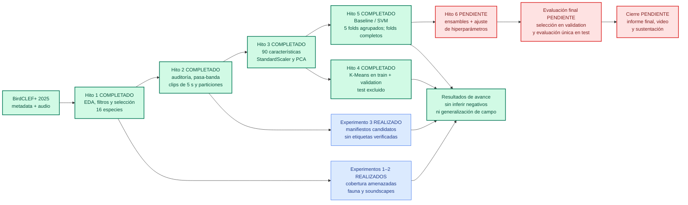

**Leyenda:** verde = hito completado; rojo = hito o etapa del plan pendiente; azul = experimento complementario. El Hito 5 está completado como comparación de validación cruzada; la evaluación final en `test` sigue pendiente.

### 4.1 Hito 1 — EDA y selección del subconjunto

El objetivo del Hito 1 fue caracterizar el catálogo y definir una tarea de clasificación regional manejable, con diversidad y soporte suficiente por clase. El [informe EDA](https://github.com/veroserna/Proyecto-1-MIAA/blob/main/docs/hito1_eda_report.md) analiza el metadata de BirdCLEF+ 2025 y los archivos disponibles:

| Indicador | Resultado reportado |
|---|---:|
| Grabaciones focales | 28.564 |
| Especies | 206: 146 aves, 34 anfibios, 17 insectos y 9 mamíferos |
| Duración total / mediana | 280,5 h / 21,0 s |
| Rango de grabaciones por especie | 2–990; razón máximo/mínimo **495:1**; Gini **0,59** |
| Especies con menos de 20 grabaciones | 53 |
| Grabaciones a ≤300 km de El Silencio | 10,4 % |
| Grabaciones dentro de Colombia | 27,1 % |
| Soundscapes locales sin etiqueta | 9.726 archivos, 162,1 h, 56 sitios y 116.712 ventanas potenciales de 5 s |

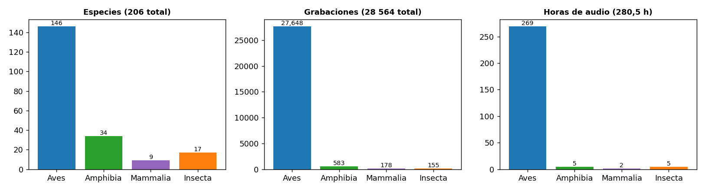

**Figura 4.1.** Resumen por grupo taxonómico y volumen de grabaciones. Da contexto al desbalance del corpus; no representa desempeño de un clasificador.

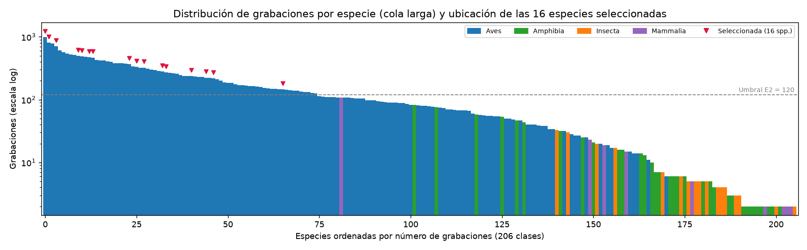

**Figura 4.2.** Conteos por especie en escala de cola larga. La concentración de registros en pocas especies justifica filtrar el universo y reportar métricas macro.

El EDA revisó volumen y duración, calidad/rating, etiquetas secundarias, tipos de vocalización, geografía, cobertura temporal de soundscapes, duplicados y estructura de particiones. También encontró límites relevantes: 2.314 grabaciones duran menos de 5 s; solo 9,3 % tiene etiquetas secundarias; el campo `type` está incompleto y no normalizado; y las grabaciones de entrenamiento son mayormente focales, mientras que los soundscapes representan audio pasivo en campo. Por tanto, las etiquetas por grabación pueden ser débiles para ventanas individuales y la diferencia entre dominios no se resuelve con el EDA.

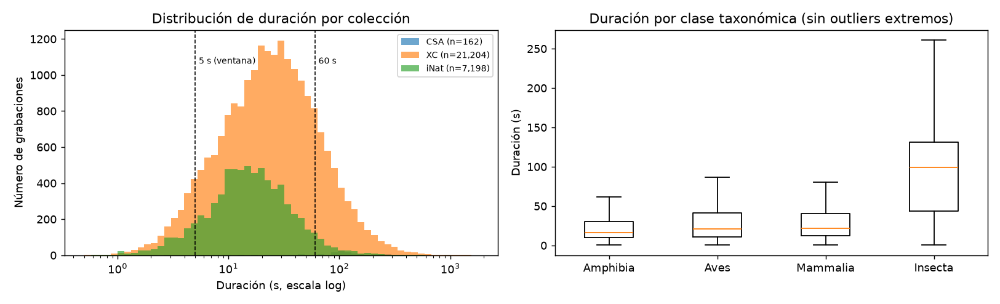

**Figura 4.3.** Duración de las grabaciones focales. La cola de grabaciones cortas y largas apoya la decisión de trabajar con clips y documentar el acondicionamiento de audios menores de 5 s.

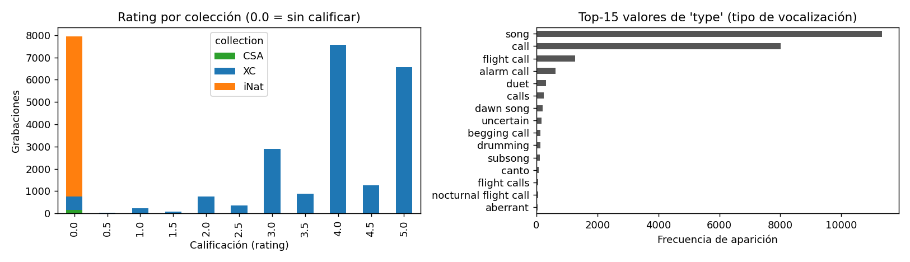

**Figura 4.4.** Distribución de calidad y tipos de vocalización reportados. La calidad y el campo `type` son metadatos de selección/diagnóstico, no etiquetas predictoras sustitutas.

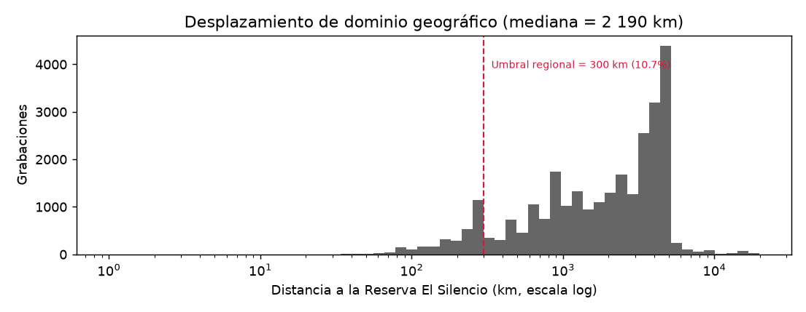

**Figura 4.5.** Distribución de distancia al sitio de estudio. Respalda la observación de cobertura regional limitada y el riesgo de cambio de dominio.

#### 4.1.1 Justificación de selección de datos

La selección se hizo en dos niveles:

1. **Elegibilidad por especie:** aves; al menos 120 grabaciones; al menos 60 con `rating ≥ 4`; al menos 40 autores; y al menos 10 grabaciones dentro de un radio de 300 km de El Silencio. De 206 especies, 57 cumplieron todos los filtros cuantitativos.
2. **Selección curada de 16 especies:** máximo dos especies por familia; cobertura de especies diurnas, crepusculares y nocturnas y de distintos estratos/hábitats; inclusión de relevancia regional; pares acústicamente confundibles; y desempate a favor de evidencia regional.

El subconjunto final abarca 14 familias y 11 órdenes, con **6.759 grabaciones y 71,4 h**. La razón máximo/mínimo es **6,77:1** (982 grabaciones de `grekis` frente a 145 de `colcha1`; Gini 0,284), mucho menor que 495:1 en el total, aunque sigue siendo un desbalance que requiere evaluación macro. La selección también reconoce una limitación: `colcha1` tiene 88 % de grabaciones regionales, mientras `grekis` y `compau` tienen menos de 7 %, lo que podría permitir atajos por canal o ambiente.

La unidad de selección para entrenamiento fue la grabación. Se conservaron las etiquetas primaria y secundarias que pertenecían al subconjunto, se exigió duración mínima de 1 s, se filtraron audios XC con rating inferior a 2 y se deduplicó por URL. Quedaron 6.759 registros; las etiquetas secundarias internas representan aproximadamente 2,23 % del subconjunto.

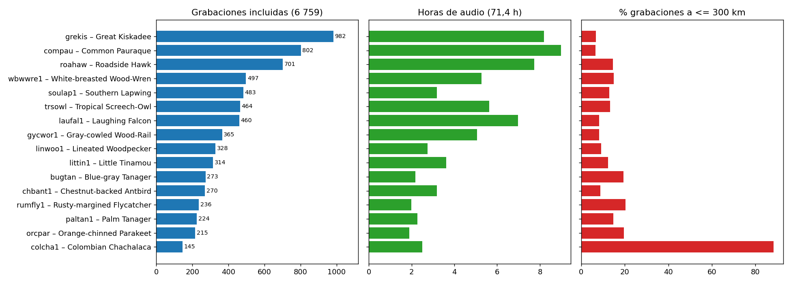

**Figura 4.6.** Comparación de soporte por especie después de la selección. Se observa menor desbalance que en el corpus completo, aunque persisten diferencias que motivan ponderación y métricas macro.

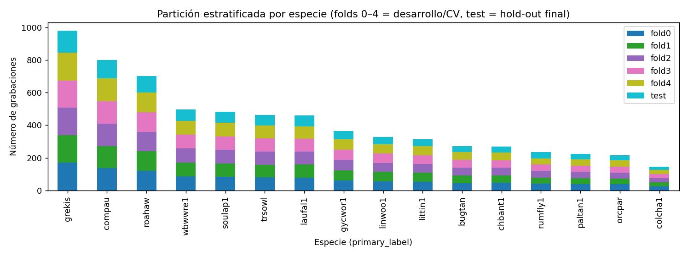

**Figura 4.7.** Distribución de los ejemplos por especie y partición. Complementa la descripción del protocolo; la garantía de no solapamiento de autores/grabaciones se verifica en la auditoría del Hito 2.

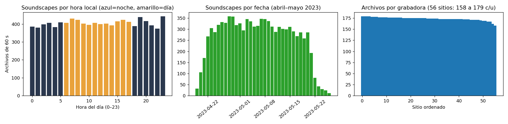

**Figura 4.8.** Cobertura del conjunto PAM de El Silencio. Estos archivos representan el dominio de campo, pero al no tener etiquetas no son negativos ni prueba supervisada.

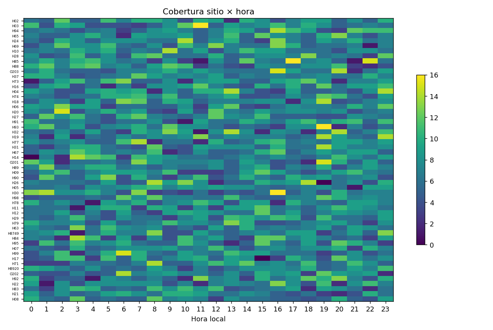

**Figura 4.9.** La cobertura por sitio y hora confirma la extensión temporal y espacial del conjunto PAM, pero no aporta etiquetas de presencia/ausencia.

**Hallazgo observado:** el subconjunto reduce el desbalance frente al corpus completo y permite una primera comparación controlada. No representa toda la fauna del ecosistema; se observan sesgos de cobertura, etiquetas débiles por ventana y cambio de dominio.

### 4.2 Hito 2 — Acondicionamiento de audio

**Objetivo:** estandarizar el audio y producir clips comparables, con control de calidad y particiones sin fuga.

**Proceso y resultados:**

- Se verificaron los **6.759** archivos esperados: 100 % existentes, con cabecera OGG válida, 32 kHz, mono y etiqueta primaria dentro de las 16 especies. Tres archivos no mostraron la bandera EOS esperada, aunque el informe registra decodificación exitosa del conjunto.
- Se aplicó un filtro Butterworth pasa-banda de orden 4 en SOS, fase cero, de **150–14.000 Hz**, remoción de DC, normalización a 32 kHz/mono y segmentación en clips de 5 s.
- De **36.939** ventanas candidatas se seleccionaron **20.748 clips** (28,82 h), hasta cuatro por grabación. Las grabaciones de 1 a menos de 5 s se acondicionaron con repetición cíclica suavizada.
- La energía media conservada en banda fue **78,65 %**; la energía fuera de banda removida fue **21,35 %**. La mediana de SNR fue **13,40 dB**, la mediana de nivel **−33,05 dBFS**, y 91,94 % quedó en niveles de calidad `high` o `medium` según el informe.
- Train: **14.296** clips; validation: **3.597**; test: **2.855**. Se reportaron cero grabaciones compartidas y cero autores compartidos entre las particiones, y ningún audio fuente dividido entre ellas.

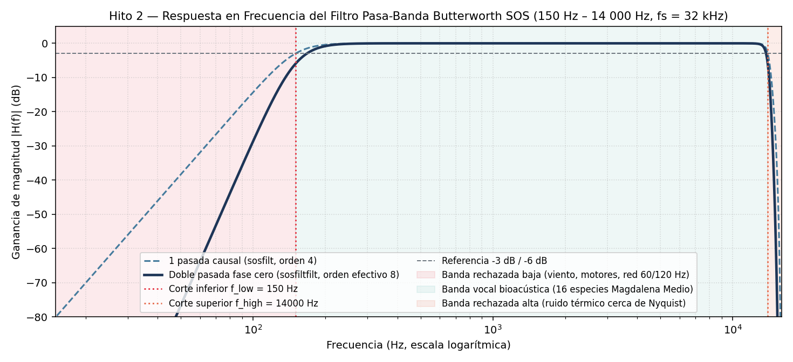

**Figura 4.10.** Respuesta del filtro Butterworth 150–14.000 Hz aplicado en fase cero. Hace visible qué bandas se preservan y atenúan; la selección de cortes se diseñó para vocalizaciones de aves.

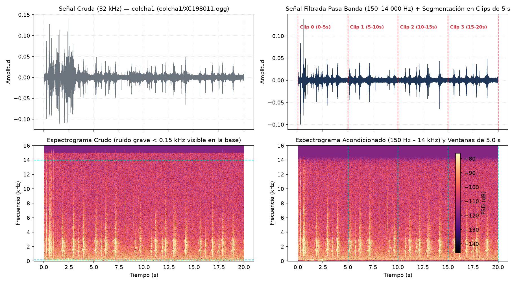

**Figura 4.11.** Ejemplo de señal antes/después del acondicionamiento. Es una ilustración del procesamiento, no una comparación de precisión predictiva.

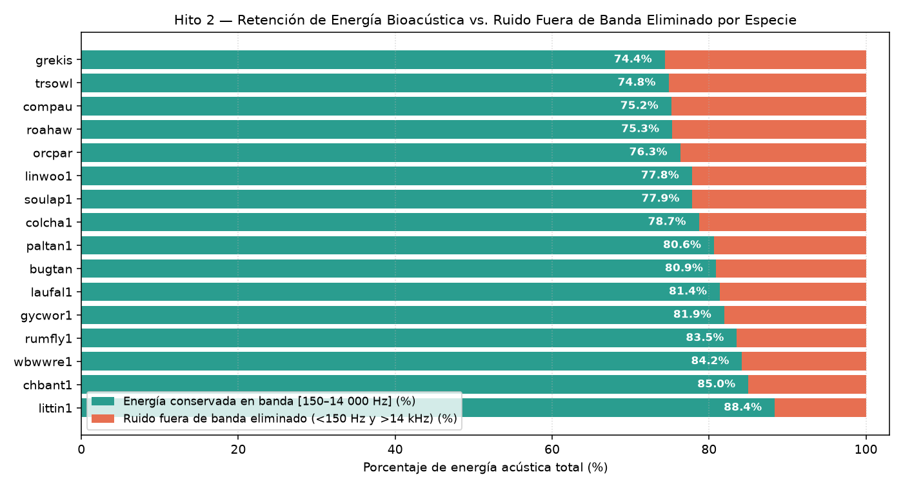

**Figura 4.12.** Distribución de energía conservada/removida que sustenta los promedios de 78,65 % y 21,35 %.

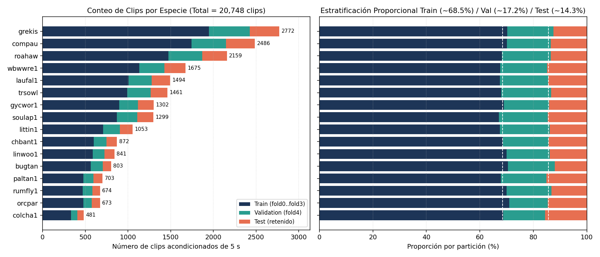

**Figura 4.13.** Conteos de clips producidos para train, validation y test; se complementa con la comprobación de no solapamiento de la Figura 4.15.

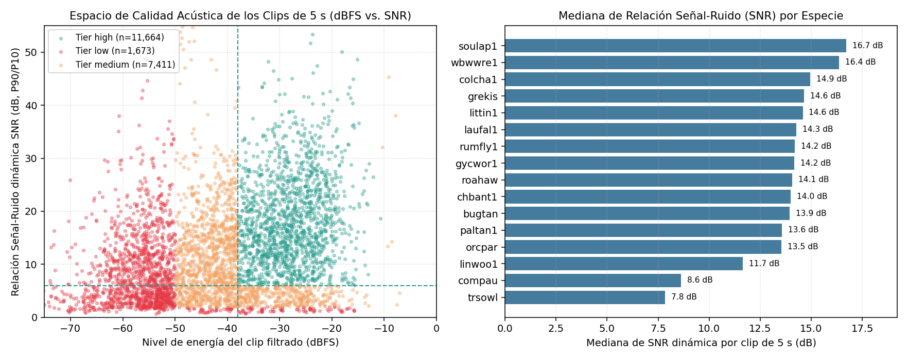

**Figura 4.14.** Calidad acústica de los clips según SNR y nivel dBFS. La figura caracteriza los datos procesados; no demuestra que mayor SNR cause mejor clasificación.

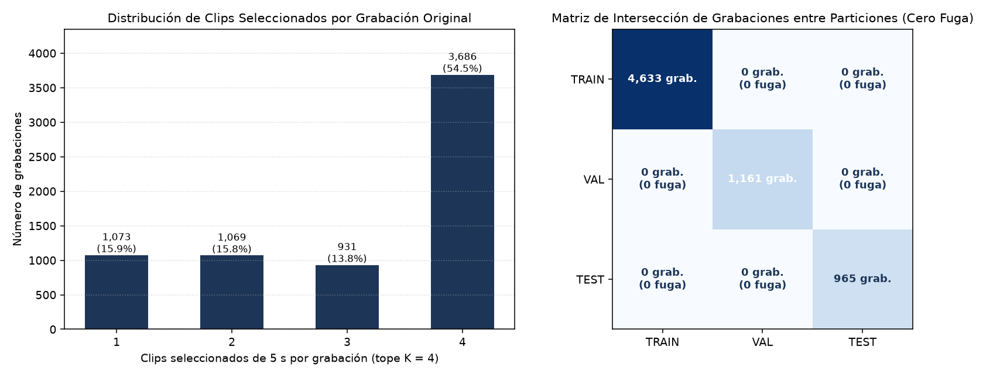

**Figura 4.15.** Verificación del agrupamiento por grabación/autor entre train, validation y test. El resultado reportado es cero intersecciones, condición para una evaluación menos optimista por duplicados relacionados.

**Hallazgo observado:** el pipeline alcanzó cobertura completa y documentó controles de fuga. Las mediciones de SNR y energía describen los clips producidos; en el avance documentado no aparece una ablación del filtro o del criterio de actividad sobre la clasificación. El pasa-banda se diseñó para aves y no se ha evaluado para clases ambientales como lluvia, agua o maquinaria.

### 4.3 Hito 3 — Características y PCA

**Objetivo:** representar cada clip con características tabulares reproducibles y explorar su estructura sin utilizar test para ajustar transformaciones.

Las variables predictoras son **90 descriptores derivados del audio**:

| Familia de características | Construcción | Número |
|---|---|---:|
| MFCC base | 13 coeficientes, media y desviación estándar | 26 |
| Delta-MFCC | 13 coeficientes temporales de primer orden, media y desviación | 26 |
| Delta-delta MFCC | 13 coeficientes temporales de segundo orden, media y desviación | 26 |
| Estadísticos espectrales | Centroide, ancho de banda, roll-off, ZCR, asimetría y curtosis; media y desviación | 12 |
| **Total** | | **90** |

Se eligieron por representar timbre/envolvente espectral y su variación temporal con un vector compacto, compatible con modelos clásicos y análisis reproducible. Se excluyeron como predictores la etiqueta, el autor, la grabación, el archivo, la partición, las coordenadas, la colección, el rating y otras variables de procedencia: pueden revelar identidad o dominio y crear fuga/atajos. `author` y `recording_id` se conservan para agrupar particiones y resultados; SNR y medidas de calidad se usan para diagnóstico, no como características acústicas principales del clasificador. Las variables de metadatos sirven para selección, control y análisis de error, no como sustituto de la señal.

**Resultados:** se procesaron los **20.748 clips** (100 %) en **90 características**. La auditoría reportó cero clips faltantes/ inválidos, cero valores numéricos inválidos y 20.748 identificadores únicos. `StandardScaler` y PCA se ajustaron solo con los 14.296 clips train. La validación numérica independiente confirmó media de entrenamiento prácticamente cero y desviación estándar prácticamente uno.

PC1 explica 25,94 %, PC2 5,94 % y PC3 4,78 % de la varianza; los acumulados son **31,89 % en 2D** y **36,67 % en 3D**. La nube PCA presenta solapamiento visual; esta figura no es una métrica de clasificación y no permite concluir que los modelos supervisados fallarán.

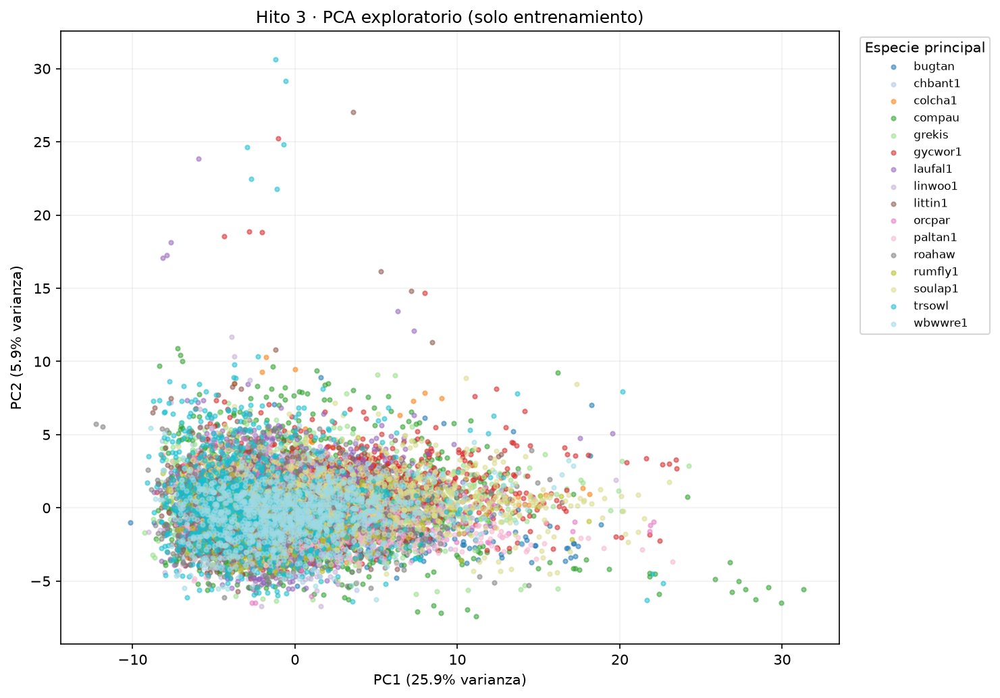

**Figura 4.16.** Proyección de PC1–PC2, coloreada por especie. El solapamiento indica que las primeras componentes no separan visualmente las clases; solo explican 31,89 % de la varianza.

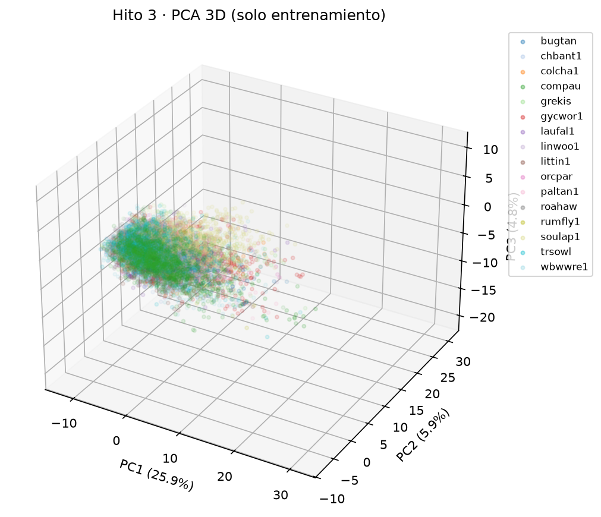

**Figura 4.17.** Proyección PC1–PC3. Las tres componentes explican 36,67 % de la varianza acumulada; la visualización sigue siendo una reducción exploratoria y no un resultado de clasificación.

**Hallazgo observado:** el hito produjo una representación completa y escalada, con el ajuste global de transformaciones limitado a entrenamiento. En la validación cruzada supervisada se documenta el reajuste del escalador dentro de cada fold; PCA continúa siendo exploratorio.

### 4.4 Hito 4 — Clustering exploratorio

**Objetivo:** evaluar si las características agrupan por especie sin usar las etiquetas durante el ajuste, y estudiar descriptivamente la relación entre calidad y asignación.

**Diseño:** K-Means, `k=16`, 90 características estandarizadas, `n_init=10`, semilla 42. Se usaron **17.893 clips train + validation** y se excluyó test. Las etiquetas se utilizaron después del ajuste para calcular ARI/alineación.

| Métrica / diagnóstico | Resultado |
|---|---:|
| Adjusted Rand Index vs. especie | **0,0320** |
| Silhouette | **0,0206** |
| Coincidencia con especie mayoritaria del cluster | 3.769 / 17.893 (**21,1 %**) |
| SNR medio de clips alineados / no alineados | 16,32 / 14,65 dB |
| Spearman(distancia al centroide, SNR) | ρ = 0,348 |
| Spearman(distancia al centroide, energía en banda) | ρ = 0,271 |
| ARI vs. especie en 5 semillas | 0,0308–0,0335 |
| ARI por pares entre soluciones | 0,590–0,891 |

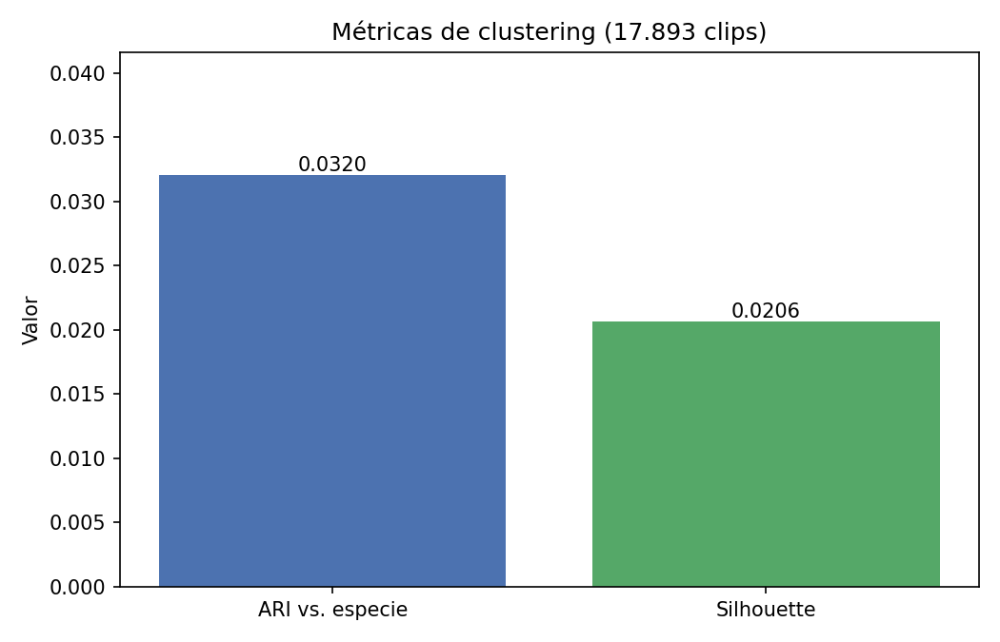

**Figura 4.18.** ARI bajo y Silhouette cercano a cero sostienen la conclusión de poca correspondencia con especies y escasa separación interna para K-Means.

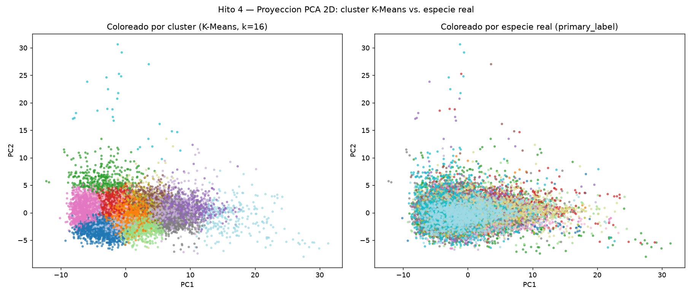

**Figura 4.19.** Comparación visual de la asignación de K-Means y las etiquetas reales en PC1–PC2. El solapamiento es consistente con ARI bajo, pero la proyección solo muestra una parte de la variación.

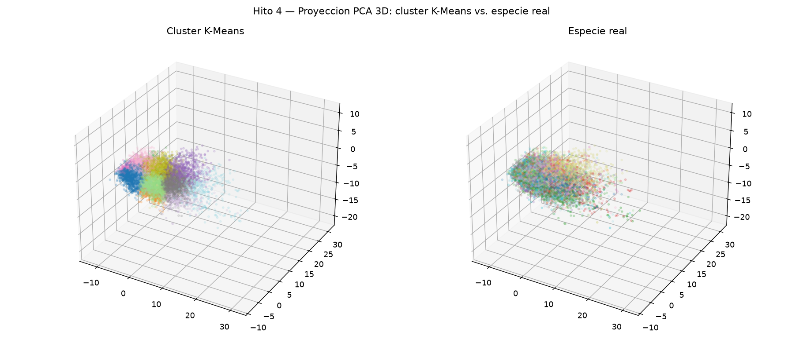

**Figura 4.20.** Vista en tres componentes de las asignaciones y especies. La reducción a tres dimensiones no representa el espacio completo de 90 características.

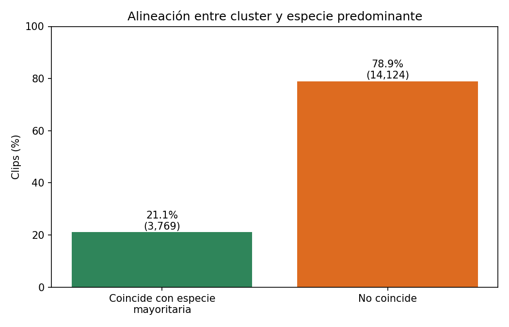

**Figura 4.21.** Solo 21,1 % de los clips coincide con la etiqueta mayoritaria de su cluster. La alineación es un resumen descriptivo y no reemplaza ARI ni las métricas supervisadas.

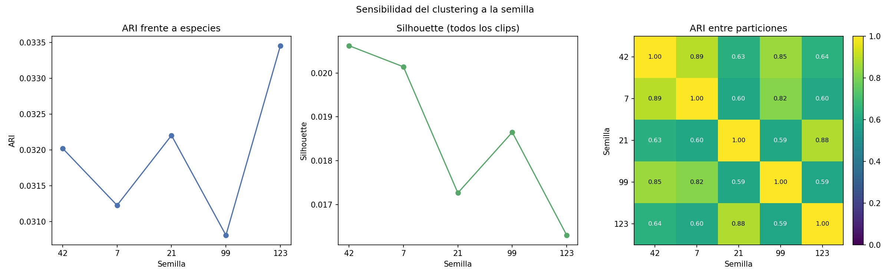

**Figura 4.22.** ARI frente a especie permanece bajo entre cinco semillas; el acuerdo entre particiones varía, lo que muestra sensibilidad parcial a la inicialización.

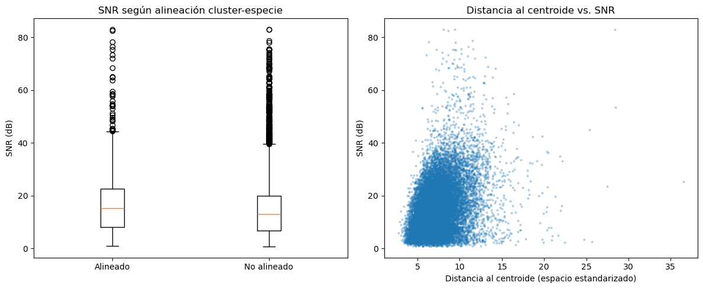

**Figura 4.23.** Diagnóstico exploratorio de distancia/SNR. La correlación positiva reportada no demuestra que el ruido cause una asignación o separación específica.

**Hallazgo observado:** K-Means mostró baja concordancia con las especies y escasa separación interna. Las asociaciones entre distancia, SNR y energía son descriptivas, no causales. Este resultado corresponde al análisis no supervisado; `k=16` se fijó por el número de especies y no por una optimización del número de clusters.

## 5. Experimentos complementarios

### 5.1 Experimento 1 — Cobertura de especies amenazadas

**Pregunta:** ¿hay cobertura supervisada suficiente para incluir el paujil de pico azul (*Crax alberti*) y el chavarrí (*Chauna chavaria*) en el clasificador principal de 16 especies?

| Especie | Grabaciones | Horas | Autores | Rating ≥4 | ≤300 km | Regionales rating ≥4 |
|---|---:|---:|---:|---:|---:|---:|
| *Crax alberti* (`bubcur1`) | 20 | 0,24 | 7 | 9 | 8 | 5 |
| *Chauna chavaria* (`norscr1`) | 14 | 0,21 | 10 | 8 | 10 | 6 |

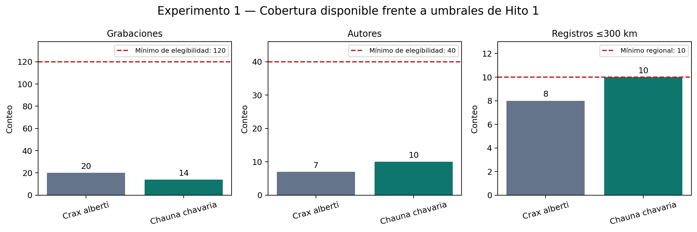

**Figura 5.1.** Las barras comparan los conteos de las dos especies con los mínimos de grabaciones, autores y registros regionales de Hito 1. Se observa la baja cobertura relativa; alcanzar un umbral de conteo no implica suficiencia para un modelo fiable.

Ambas quedan por debajo de los umbrales de Hito 1 (120 grabaciones, 60 con rating ≥4, 40 autores); solo *Chauna chavaria* alcanza el mínimo de 10 grabaciones a ≤300 km. Incorporarlas elevaría la razón de volumen máximo/mínimo estimada de 6,77:1 a aproximadamente **70,14:1**. Las 34 grabaciones no constituyen 34 muestras independientes largas ni permiten inferir precisión.

**Resultado del experimento:** el informe de cobertura deja ambas especies fuera del benchmark multiclase principal por no cumplir los umbrales de soporte. La decisión responde a la disponibilidad actual de datos, no a su importancia de conservación ni a la reconocibilidad acústica. El experimento auditó cobertura; no entrenó un modelo ni midió reconocibilidad.

### 5.2 Experimento 2 — Rechazo de fauna no objetivo y sonidos ambientales

**Pregunta:** ¿hay ejemplos suficientes para que el modelo de 16 aves aprenda a rechazar fauna distinta y ambientes?

- Tras los filtros de duración, calidad y deduplicación, hay **904 grabaciones no aviares**: 576 anfibios, 154 insectos y 174 mamíferos, correspondientes a 60 especies y 11,47 h. **46 de las 60 especies tienen menos de 20 grabaciones**.
- Solo cinco de esas 904 contienen alguna etiqueta secundaria; una incluye `compau`, una de las aves objetivo. La falta de etiqueta secundaria en las otras 903 no certifica ausencia de las aves objetivo.
- Los **9.726 soundscapes** (162,1 h; hasta 116.712 ventanas candidatas de 5 s) no tienen anotaciones de presencia/ausencia. No deben tratarse automáticamente como negativos.

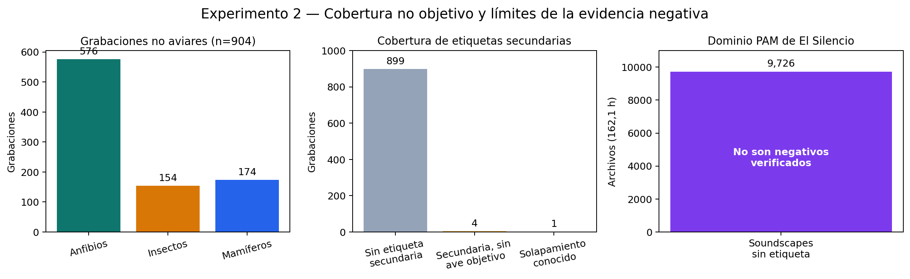

**Figura 5.2.** Panel izquierdo: conteos no aviares por grupo taxonómico. Panel central: cobertura de etiquetas secundarias; “sin etiqueta secundaria” significa desconocido, no negativo. Panel derecho: volumen de soundscapes sin etiqueta supervisada.

**Estado del experimento:** los datos disponibles describen un posible pool de candidatos, pero no se entrenó ni evaluó un clasificador de rechazo. Las etiquetas negativas no están verificadas, por lo que las tasas de falsas alarmas y de rechazo no se han medido.

### 5.3 Experimento 3 — Extensión del pipeline para candidatos de rechazo

El notebook de extensión del Hito 2 genera tablas separadas de candidatos de fauna no aviar y de soundscapes, conservando el pipeline de las 16 aves como referencia. Las 904 filas de fauna tienen estado de **candidato débil no verificado**; no se convirtieron a clips supervisados ni a negativos limpios.

De los 903 candidatos sin coincidencia secundaria conocida, 786 quedaron asignados a train, 51 a validation y 66 a test; son conteos de un pool débil y no equivalen a tamaños de evaluación fiables. El único caso de coincidencia conocida se conserva excluido de negativos monoetiqueta. Los soundscapes se dividieron por sitio para prevenir cruces entre particiones: 6.610 train, 1.216 validation y 1.900 test; siguen sin etiqueta y no se usan como positivos o negativos supervisados.

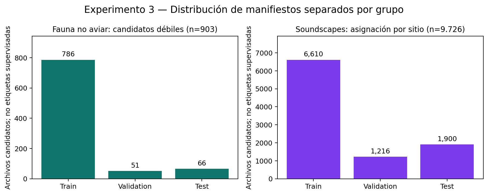

**Figura 5.3.** Distribuciones de archivos por partición para candidatos débiles de fauna y soundscapes agrupados por sitio. Los tamaños no equivalen a positivos/negativos validados ni a conjuntos de evaluación supervisada.

**Estado del experimento:** se verificaron el inventario y la asignación de grupos, no una mejora predictiva. No se decodificó ni acondicionó audio adicional para entrenamiento. Los manifiestos no convierten la ausencia de metadatos en ausencia de aves.

## 6. Modelos de referencia y pruebas supervisadas iniciales

El [informe de Hito 5](https://github.com/veroserna/Proyecto-1-MIAA/blob/main/docs/hito5_baseline_svm_report.md) describe una comparación completada mediante validación cruzada de cinco folds agrupados por autor, agregación de scores por grabación y exclusión de test. Los modelos son regresión logística One-vs-Rest y SVM lineal, RBF y polinomial, con `class_weight="balanced"`. En la corrida más reciente se usaron todos los clips disponibles en cada fold de entrenamiento.

| Modelo (corrida con folds completos) | Macro-F1 | Precision macro | Recall macro | Macro ROC-AUC | Accuracy exact-match |
|---|---:|---:|---:|---:|---:|
| Baseline — regresión logística OvR | 0,299 ± 0,007 | 0,185 ± 0,005 | 0,883 ± 0,005 | 0,894 ± 0,005 | 0,025 ± 0,004 |
| SVM lineal | 0,302 ± 0,006 | 0,189 ± 0,004 | **0,885 ± 0,004** | 0,894 ± 0,007 | 0,026 ± 0,005 |
| SVM RBF | **0,466 ± 0,019** | **0,343 ± 0,019** | 0,765 ± 0,010 | **0,908 ± 0,004** | 0,206 ± 0,025 |
| SVM polinomial | 0,417 ± 0,017 | 0,304 ± 0,012 | 0,698 ± 0,022 | 0,874 ± 0,006 | 0,186 ± 0,013 |

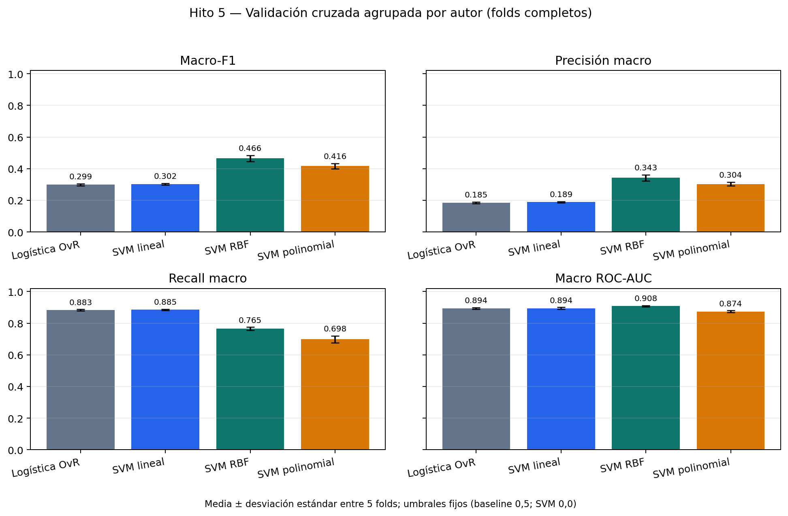

**Figura 6.1.** Promedio y desviación estándar entre los cinco folds, entrenando los SVM con todos los clips de cada fold. Se muestran Macro-F1, precisión, recall y ROC-AUC; la exact match se mantiene en la tabla porque su escala baja dificultaría comparar las otras métricas en la misma gráfica.

**Lectura del avance:** SVM RBF obtiene los mayores Macro-F1 y Macro ROC-AUC entre los modelos de esta corrida. Baseline y SVM lineal presentan recall alto y precisión baja bajo los umbrales fijos usados. La exact match es muy estricta para multilabel. Los resultados son de validación cruzada, no de la evaluación final en `test` ni de soundscapes de campo.

La corrida anterior con límite de 1.500 clips por fold queda reemplazada como resultado actual por la ejecución completa. El Hito 5 queda cerrado como línea base de validación cruzada con umbrales fijos; el Hito 6 y la evaluación final permanecen pendientes.

## 7. Alcance y límites de la exploración

### Aspectos documentados

- La selección de especies se sustenta en criterios explícitos de volumen, rating, autores, cercanía y diversidad ecológica, y no solo en frecuencia.
- El análisis considera distribución, duración, licencias, etiquetas secundarias, geografía y soundscapes; esto hace visibles sesgos relevantes antes del entrenamiento.
- Los pipelines dejan artefactos reproducibles y reportan semillas, número de clips, particiones y métricas.
- Las particiones se agrupan por grabación y autor; el test se excluye del clustering y de la comparación supervisada inicial.
- Las características predictoras se limitan a descriptores de audio; autor, procedencia e identidad se conservan para auditoría y control.
- Se distingue correctamente entre evidencia descriptiva (PCA, correlaciones, cobertura) y evidencia predictiva (validación supervisada).

### Límites de la evidencia al corte

- **Cambio de dominio:** grabaciones focales de entrenamiento no equivalen a soundscapes polifónicos del sitio de interés. No se reporta una evaluación de campo con etiquetas expertas.
- **Etiquetas débiles:** una etiqueta de grabación no garantiza presencia en cada clip; las etiquetas secundarias son escasas y no permiten certificar negativos.
- **Representatividad regional desigual:** el subconjunto balancea familias y gremios, pero el número de audios locales varía mucho entre clases.
- **Ablaciones no incluidas en este corte:** no se cuantifica por separado el efecto del filtro, la selección por actividad, las características o la estrategia de balanceo.
- **Modelos supervisados:** Macro-F1 se calculó con umbrales fijos (baseline 0,5 y SVM 0,0), no optimizados por fold. La CV del Hito 5 no es la evaluación final y no incluye test ni soundscapes anotados.

## 8. Estado del avance y etapas pendientes

| Hito o etapa del plan | Estado al corte | Evidencia / alcance |
|---|---|---|
| Hito 1 — EDA y selección de especies | Completado | Informe y artefactos de EDA; 16 especies seleccionadas |
| Hito 2 — Acondicionamiento y particiones | Completado | 20.748 clips; auditoría de integridad y particiones |
| Hito 3 — Características y PCA | Completado | 90 características; validación numérica aprobada; la celda de avance del plan está vacía |
| Hito 4 — Clustering exploratorio | Completado | K-Means y métricas calculadas sobre train + validation |
| Hito 5 — Baseline y SVM | Completado | Cinco folds agrupados por autor; corrida actual con todos los clips de cada fold; umbrales fijos; linea base CV |
| Hito 6 — Ensambles y ajuste | Pendiente | Actividad planificada para el 16–20 de noviembre |
| Evaluación final en test | Pendiente | Actividad planificada para el 23–27 de noviembre; no se reporta como ejecutada |
| Informe final, video y sustentación | Pendientes | Cierre planificado para el 30 de noviembre–2 de diciembre |

Los Experimentos 1–3 son complementarios y no sustituyen los hitos pendientes del plan. La evaluación sobre soundscapes de campo tampoco se considera completada en este corte.

## 9. Fuentes y artefactos

- [Plan de trabajo](https://github.com/veroserna/Proyecto-1-MIAA/blob/main/docs/plan_trabajo.md)
- [Árbol de problemas](https://github.com/veroserna/Proyecto-1-MIAA/blob/main/docs/arbol-problemas.md)
- [Informe EDA del Hito 1](https://github.com/veroserna/Proyecto-1-MIAA/blob/main/docs/hito1_eda_report.md) y [notebook](https://github.com/veroserna/Proyecto-1-MIAA/blob/main/notebooks/hito1_eda_seleccion_especies.ipynb)
- [Informe de acondicionamiento del Hito 2](https://github.com/veroserna/Proyecto-1-MIAA/blob/main/docs/hito2_acondicionamiento_report.md) y [notebook](https://github.com/veroserna/Proyecto-1-MIAA/blob/main/notebooks/hito2_acondicionamiento_audio.ipynb)
- [Informe de características del Hito 3](https://github.com/veroserna/Proyecto-1-MIAA/blob/main/docs/hito3_features_report.md) y [notebook](https://github.com/veroserna/Proyecto-1-MIAA/blob/main/notebooks/hito3_analisis_features.ipynb)
- [Informe de clustering del Hito 4](https://github.com/veroserna/Proyecto-1-MIAA/blob/main/docs/hito4_clustering_report.md) y [notebook](https://github.com/veroserna/Proyecto-1-MIAA/blob/main/notebooks/hito4_clustering.ipynb)
- [Informe de baseline/SVM del Hito 5](https://github.com/veroserna/Proyecto-1-MIAA/blob/main/docs/hito5_baseline_svm_report.md) y [resumen de CV](https://github.com/veroserna/Proyecto-1-MIAA/blob/main/experiments/results/hito4_5/supervised/cv_summary.json)
- [Experimento 1: especies amenazadas](https://github.com/veroserna/Proyecto-1-MIAA/blob/main/docs/experimento_01_especies_amenazadas.md)
- [Experimento 2: fauna no objetivo y rechazo](https://github.com/veroserna/Proyecto-1-MIAA/blob/main/docs/experimento_02_rechazo_fauna_ambiente.md) y [notebook del Experimento 2](https://github.com/veroserna/Proyecto-1-MIAA/blob/main/notebooks/experimento_02_rechazo_fauna_ambiente.ipynb)
- [Notebook del Experimento 3: extensión de Hito 2](https://github.com/veroserna/Proyecto-1-MIAA/blob/main/notebooks/experimento_03_pipeline_hito2_rechazo_fauna_ambiente.ipynb)
